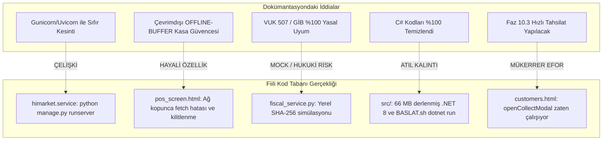
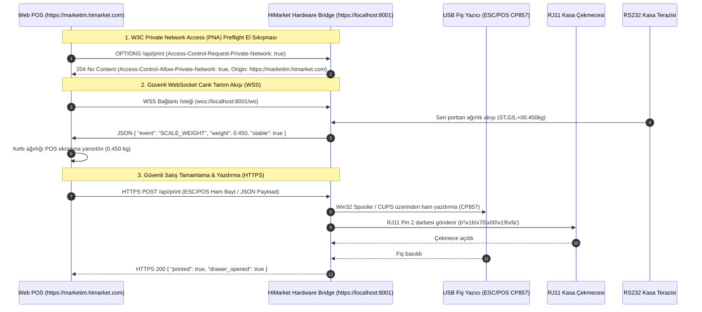
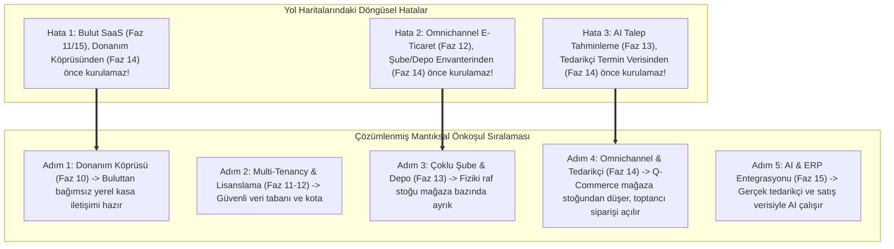
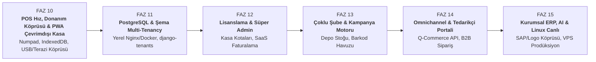

# HİMARKET POS & ERP KAPSAMLI DENETİM, MİMARİ AÇIKLAR VE SAHA UYUMLULUK RAPORU
**Doküman Kodu:** AUDIT-HM-2026-V1  
**Tarih:** 17 Kasım 2026  
**Sürüm Denetlenen:** HiMarket POS v2.6.0  
**Hedef Kitle:** Baş Mimar (Lead Architect), Ürün Yöneticisi, Backend & Frontend Mühendisleri, Saha Dağıtım Ekipleri  
**Statü:** Nihai Denetim Raporu (Resmi Kabul Öncesi Zorunlu Düzeltmeler)

---

## İÇİNDEKİLER
1. [YÖNETİCİ ÖZETİ (EXECUTIVE SUMMARY)](#1-yönetici-özeti-executive-summary)
   - 1.1. [Projenin Mevcut Olgunluk Durumu](#11-projenin-mevcut-olgunluk-durumu)
   - 1.2. [Temel Risk Özeti ve Kritik Bulgular Matrisi](#12-temel-risk-özeti-ve-kritik-bulgular-matrisi)
   - 1.3. [Mimari Paradigma Uyuşmazlığı](#13-mimari-paradigma-uyuşmazlığı)
2. [BÖLÜM 1: DOKÜMANTASYON, DAĞITIM KILAVUZLARI VE KOD TABANI DENETİMİ](#2-bölüm-1-dokümantasyon-dağıtım-kılavuzları-ve-kod-tabanı-denetimi)
   - 2.1. [Gözlem 1: Prodüksiyon Systemd Servisinde Gunicorn Yerine `runserver` Kullanımı](#21-gözlem-1-prodüksiyon-systemd-servisinde-gunicorn-yerine-runserver-kullanımı)
   - 2.2. [Gözlem 2: Mimari Uyuşmazlık — Yerel Tekil Mağaza (`CompanySetting` Singleton) vs. Bulut SaaS](#22-gözlem-2-mimari-uyuşmazlık--yerel-tekil-mağaza-companysetting-singleton-vs-bulut-saas)
   - 2.3. [Gözlem 3: Dokümantasyondaki Hayali "Çevrimdışı Kasa Güvencesi" (`OFFLINE-BUFFER`)](#23-gözlem-3-dokümantasyondaki-hayali-çevrimdışı-kasa-güvencesi-offline-buffer)
   - 2.4. [Gözlem 4: Çevrimdışı Çalışmayı Felç Eden Harici CDN Bağımlılıkları](#24-gözlem-4-çevrimdışı-çalışmayı-felç-eden-harici-cdn-bağımlılıkları)
   - 2.5. [Gözlem 5: 66 MB Atıl C# .NET 8 Kod Kalıntıları ve Paketleme Şişmesi](#25-gözlem-5-66-mb-atıl-c-net-8-kod-kalıntıları-ve-paketleme-şişmesi)
   - 2.6. [Gözlem 6: Güvenlik Yapılandırması Zaafiyetleri (`SECRET_KEY`, `ALLOWED_HOSTS`, `static.serve`)](#26-gözlem-6-güvenlik-yapılandırması-zaafiyetleri-secret_key-allowed_hosts-staticserve)
   - 2.7. [Gözlem 7: Yasal Uyumluluk Beyanları (VUK 507, ÖKC) vs. Yerel SHA-256 Mock Gerçekliği](#27-gözlem-7-yasal-uyumluluk-beyanları-vuk-507-ökc-vs-yerel-sha-256-mock-gerçekliği)
   - 2.8. [Gözlem 8: Faz Yol Haritası Mükerrerliği — Faz 10.3 Hızlı Tahsilatın Halihazırda Mevcut Olması](#28-gözlem-8-faz-yol-haritası-mükerrerliği--faz-103-hızlı-tahsilatın-halihazırda-mevcut-olması)
   - 2.9. [Gözlem 9: Güncelliğini Yitirmiş README.md Test Sayısı (27 Test vs. 92 Test)](#29-gözlem-9-güncelliğini-yitirmiş-readmemd-test-sayısı-27-test-vs-92-test)
   - 2.10. [Gözlem 10: Masaüstü Kısayolları ve Launchd Plist Dosyasında Sabit Kullanıcı Yolları](#210-gözlem-10-masaüstü-kısayolları-ve-launchd-plist-dosyasında-sabit-kullanıcı-yolları)
3. [BÖLÜM 2: TÜRKİYE PERAKENDE PİYASASI SAHA OPERASYONLARI VE DONANIM UYUMLULUĞU](#3-bölüm-2-türkiye-perakende-piyasası-saha-operasyonları-ve-donanım-uyumluluğu)
   - 3.1. [Barkodlu Teraziler ve GS1 Türkiye Ayrıştırma Motoru](#31-barkodlu-teraziler-ve-gs1-türkiye-ayrıştırma-motoru)
     - 3.1.1. [27 (Ağırlık), 28 (Fiyat/Tutar) ve 29 (Mağaza İçi) Barkod Standartları](#311-27-ağırlık-28-fiyattutar-ve-29-mağaza-içi-barkod-standartları)
     - 3.1.2. [`views.py` Satır 482-508 Matematiksel Gramaj/Tutar Hatası ve Düzeltme Formülü](#312-viewspy-satır-482-508-matematiksel-gramajtutar-hatası-ve-düzeltme-formülü)
     - 3.1.3. [`barcode__contains` Riskleri ve `Product.plu_code` İhtiyacı](#313-barcode__contains-riskleri-ve-productplu_code-ihtiyacı)
     - 3.1.4. [Bizerba, Dibal, DIGI Reyon Terazilerine PLU Master Veri İhracı](#314-bizerba-dibal-digi-reyon-terazilerine-plu-master-veri-ihracı)
     - 3.1.5. [Kasa Terazisi `scale_service.py` İçindeki Sessiz Mock Ağırlık (1.250 kg) Fallback Tehlikesi](#315-kasa-terazisi-scale_servicepy-içindeki-sessiz-mock-ağırlık-1250-kg-fallback-tehlikesi)
   - 3.2. [POS Çevre Birimleri ve Yerel Donanım Köprüsü (HiMarket Hardware Bridge)](#32-pos-çevre-birimleri-ve-yerel-donanım-köprüsü-himarket-hardware-bridge)
     - 3.2.1. [ESC/POS Türkçe Karakter Sorunu (`_tr_to_ascii` vs CP857/CP1254)](#321-escpos-türkçe-karakter-sorunu-_tr_to_ascii-vs-cp857cp1254)
     - 3.2.2. [USB Termal Yazıcı Desteği ve TCP 9100 Soket Açmazı](#322-usb-termal-yazıcı-desteği-ve-tcp-9100-soket-açmazı)
     - 3.2.3. [RJ11 Kasa Çekmecesi Tetikleme Dinamikleri](#323-rj11-kasa-çekmecesi-tetikleme-dinamikleri)
     - 3.2.4. [`paper_width` KeyError Hatası (`printer_service.py` Satır 297)](#324-paper_width-keyerror-hatası-printer_servicepy-satır-297)
     - 3.2.5. [Müşteri Ekranı (Dual Screen) Kopukluğu ve Canlı Senkronizasyon](#325-müşteri-ekranı-dual-screen-kopukluğu-ve-canlı-senkronizasyon)
     - 3.2.6. [2x20 Seri VFD Kutup Ekranı Entegrasyonu](#326-2x20-seri-vfd-kutup-ekranı-entegrasyonu)
     - 3.2.7. [HiMarket Hardware Bridge Mimari Tasarımı, HTTPS/WSS Terminasyonu ve W3C PNA Güvenlik Çözümü](#327-himarket-hardware-bridge-mimari-tasarımı-httpswss-terminasyonu-ve-w3c-pna-güvenlik-çözümü)
   - 3.3. [Çevrimdışı Çalışma Mimarisi (Offline Resilience)](#33-çevrimdışı-çalışma-mimarisi-offline-resilience)
     - 3.3.1. [Ağ ve İnternet Kesintisinde Kasa Kilitlenme Analizi](#331-ağ-ve-internet-kesintisinde-kasa-kilitlenme-analizi)
     - 3.3.2. [PWA + IndexedDB Yerel Katalog ve `himarket_offline_sales` Kuyruk Modeli](#332-pwa--indexeddb-yerel-katalog-ve-himarket_offline_sales-kuyruk-modeli)
     - 3.3.3. [Arka Plan Senkronizasyonu, Veresiye Yasağı ve Mali Mevzuat Çakışma Çözümü](#333-arka-plan-senkronizasyonu-veresiye-yasağı-ve-mali-mevzuat-çakışma-çözümü)
   - 3.4. [Mali Mevzuat, ÖKC ve e-Belge Gerçekleri](#34-mali-mevzuat-ökc-ve-e-belge-gerçekleri)
     - 3.4.1. [VUK 507 Simülasyonu ve Yasal Yaptırım Riskleri](#341-vuk-507-simülasyonu-ve-yasal-yaptırım-riskleri)
     - 3.4.2. [Resmi e-Arşiv Entegratörleri (Nilvera/EDM) vs Yeni Nesil ÖKC (GMP3/TSM)](#342-resmi-e-arşiv-entegratörleri-nilveraedm-vs-yeni-nesil-ökc-gmp3tsm)
     - 3.4.3. [Bakkal/Şarküteri vs Süpermarket Yasal Rejim Ayrımı](#343-bakkalşarküteri-vs-süpermarket-yasal-rejim-ayrımı)
   - 3.5. [Kasiyer Ergonomisi, Hızı ve Arayüz (UI/UX)](#35-kasiyer-ergonomisi-hızı-ve-arayüz-uiux)
     - 3.5.1. [Modal Kalabalığının Kaldırılması (Numpad Çarpan Satışı `5*`)](#351-modal-kalabalığının-kaldırılması-numpad-çarpan-satışı-5)
     - 3.5.2. [Fonksiyon Tuşları Koruması (F1, F5 Sayfa Yenileme Engeli, F12)](#352-fonksiyon-tuşları-koruması-f1-f5-sayfa-yenileme-engeli-f12)
     - 3.5.3. [Yön Tuşlarıyla Sepet Gezinme ve `Delete` ile Satır İptali](#353-yön-tuşlarıyla-sepet-gezinme-ve-delete-ile-satır-iptali)
     - 3.5.4. [Seri Barkod Okutmada Yarış Durumu (Race Condition) Çözümü](#354-seri-barkod-okutmada-yarış-durumu-race-condition-çözümü)
     - 3.5.5. [Yetkili Onayı Sabit Parametre ('Satış İptali') Hata Düzeltmesi](#355-yetkili-onayı-sabit-parametre-satış-iptali-hata-düzeltmesi)
4. [BÖLÜM 3: FAZ 10 - FAZ 15 BAĞIMLILIK ZİNCİRİ, MİMARİ VE ÇOKLU KİRACILIK (MULTI-TENANCY) ANALİZİ](#4-bölüm-3-faz-10---faz-15-bağımlılık-zinciri-mimari-ve-çoklu-kiracılık-multi-tenancy-analizi)
   - 4.1. [Yol Haritası İkiliği: KOBİ Dağıtım Planı vs Kurumsal Vizyon](#41-yol-haritası-ikiliği-kobi-dağıtım-planı-vs-kurumsal-vizyon)
   - 4.2. [Multi-Tenancy Mimari Modellerinin Karşılaştırılması](#42-multi-tenancy-mimari-modellerinin-karşılaştırılması)
     - 4.2.1. [Shared Schema (Row-Level) vs PostgreSQL Schema-per-Tenant (`django-tenants`) vs Database-per-Tenant](#421-shared-schema-row-level-vs-postgresql-schema-per-tenant-django-tenants-vs-database-per-tenant)
     - 4.2.2. [Mevcut Model Tekillik Kısıtlamaları Çatışması (`Product.barcode`, `Sale.receipt_number`, vb.)](#422-mevcut-model-tekillik-kısıtlamaları-çatışması-productbarcode-salereceipt_number-vb)
     - 4.2.3. [Neden PostgreSQL Şema İzolasyonu HiMarket İçin Tek Geçerli Çözümdür?](#423-neden-postgresql-şema-izolasyonu-himarket-için-tek-geçerli-çözümdür)
     - 4.2.4. [`SHARED_APPS` vs `TENANT_APPS` Ayrımı ve Kasiyer Kullanıcı Adı (`kasiyer1`) İzolasyonu](#424-shared_apps-vs-tenant_apps-ayrımı-ve-kasiyer-kullanıcı-adı-kasiyer1-izolasyonu)
     - 4.2.5. [PgBouncer Transaction Havuzlama ve `SET search_path` Oturum Sızıntısı (Session Leakage) Güvenlik Mimarisi](#425-pgbouncer-transaction-havuzlama-ve-set-search_path-oturum-sızıntısı-session-leakage-güvenlik-mimarisi)
   - 4.3. [Çapraz Kiracı Veri Sızıntısı Risk Noktaları](#43-çapraz-kiracı-veri-sızıntısı-risk-noktaları)
   - 4.4. [Döngüsel Bağımlılıkların Çözümü ve Mantıksal Sıralama](#44-döngüsel-bağımlılıkların-çözümü-ve-mantıksal-sıralama)
     - 4.4.1. [Donanım Köprüsü (Faz 14) Olmadan Bulut SaaS (Faz 11/15) Çalışamaz](#441-donanım-köprüsü-faz-14-olmadan-bulut-saas-faz-1115-çalışamaz)
     - 4.4.2. [Şube/Depo Envanteri Olmadan Omnichannel Q-Commerce (Faz 12) Çalışamaz](#442-şubedepo-envanteri-olmadan-omnichannel-q-commerce-faz-12-çalışamaz)
     - 4.4.3. [Tedarikçi Portali Olmadan AI Tahminleme (Faz 13) Çalışamaz](#443-tedarikçi-portali-olmadan-ai-tahminleme-faz-13-çalışamaz)
   - 4.5. [Lisanslama, Kotalar ve Kiracı Yönetişimi (Governance Matrix)](#45-lisanslama-kotalar-ve-kiracı-yönetişimi-governance-matrix)
   - 4.6. [Ölçeklenebilirlik, POS Yüksek Yazma Hacmi ve Veritabanı Dayanıklılığı](#46-ölçeklenebilirlik-pos-yüksek-yazma-hacmi-ve-veritabanı-dayanıklılığı)
     - 4.6.1. [Tablo Bölümleme (Partitioning) Stratejisi: Katalog Şişmesi (Catalog Bloat) Önlemi ve Ortak Loglar](#461-tablo-bölümleme-partitioning-stratejisi-katalog-şişmesi-catalog-bloat-önlemi-ve-ortak-loglar)
     - 4.6.2. [PgBouncer Bağlantı Havuzlayıcı: Transaction Modu İzolasyonu ve Çift Havuz (Dual-Pool)](#462-pgbouncer-bağlantı-havuzlayıcı-transaction-modu-izolasyonu-ve-çift-havuz-dual-pool)
     - 4.6.3. [Okuma/Yazma Ayrımı (Read Replicas)](#463-okumayazma-ayrımı-read-replicas)
     - 4.6.4. [Celery Kuyruk İzolasyonu](#464-celery-kuyruk-izolasyonu)
     - 4.6.5. [1.000 Kiracıda Paralel Migration Yönetimi (`--executor=parallel`) ve Hata İzolasyonu (Failure Recovery)](#465-1000-kiracıda-paralel-migration-yönetimi---executorparallel-ve-hata-izolasyonu-failure-recovery)
5. [BÖLÜM 4: REVİZE EDİLMİŞ BİRLEŞİK MASTER YOL HARİTASI (FAZ 10 - FAZ 15)](#5-bölüm-4-revize-edilmiş-birleşik-master-yol-haritası-faz-10---faz-15)
   - 5.1. [Faz 10: POS Hız/Ergonomi (Numpad), Hafif Donanım Köprüsü & PWA Çevrimdışı Kasa Dayanıklılığı](#51-faz-10-pos-hızergonomi-numpad-hafif-donanım-köprüsü--pwa-çevrimdışı-kasa-dayanıklılığı)
   - 5.2. [Faz 11: PostgreSQL Şema Bazlı Multi-Tenancy (`django-tenants`) & Veri İzolasyonu](#52-faz-11-postgresql-şema-bazlı-multi-tenancy-django-tenants--veri-izolasyonu)
   - 5.3. [Faz 12: Kasa Başına Lisanslama, Dinamik Kotalar & Süper Admin Paneli](#53-faz-12-kasa-başına-lisanslama-dinamik-kotalar--süper-admin-paneli)
   - 5.4. [Faz 13: Çoklu Şube/Depo, İlk Giriş Sihirbazı & Kampanya Motoru](#54-faz-13-çoklu-şubedepo-ilk-giriş-sihirbazı--kampanya-motoru)
   - 5.5. [Faz 14: Omnichannel (Q-Commerce & E-Ticaret) ve B2B Tedarikçi Portali](#55-faz-14-omnichannel-q-commerce--e-ticaret-ve-b2b-tedarikçi-portali)
   - 5.6. [Faz 15: Kurumsal Entegrasyonlar (ERP/BI), AI Tahminleme & Linux Canlı Dağıtım](#56-faz-15-kurumsal-entegrasyonlar-erpbi-ai-tahminleme--linux-canlı-dağıtım)
   - 5.7. [Faz Matrisi ve Doğrulama Kriterleri Özeti](#57-faz-matrisi-ve-doğrulama-kriterleri-özeti)
6. [BÖLÜM 5: SOMUT EYLEM PLANI VE ÖNCELİKLENDİRİLMİŞ YAPILACAKLAR LİSTESİ](#6-bölüm-5-somut-eylem-planı-ve-önceliklendirilmiş-yapılacaklar-listesi)
   - 6.1. [Acil (P0 - Bloklayıcı Düzeltmeler)](#61-acil-p0---bloklayıcı-düzeltmeler)
   - 6.2. [Kısa Vade (P1 - Saha, Donanım & PWA Çevrimdışı Dayanıklılık)](#62-kısa-vade-p1---saha-donanım--pwa-çevrimdışı-dayanıklılık)
   - 6.3. [Orta Vade (P2 - Multi-Tenancy ve Lisanslama)](#63-orta-vade-p2---multi-tenancy-ve-lisanslama)
   - 6.4. [Uzun Vade (P3 - Kurumsal ve Omnichannel)](#64-uzun-vade-p3---kurumsal-ve-omnichannel)

---

## 1. YÖNETİCİ ÖZETİ (EXECUTIVE SUMMARY)

### 1.1. Projenin Mevcut Olgunluk Durumu
HiMarket POS & ERP projesi, yerel tekil mağaza (Single-Store On-Premise) işletimi açısından dikkat çekici bir fonksiyonel zenginliğe ve kod olgunluğuna ulaşmıştır. Projenin Django 5.x tabanlı çekirdeği, **92 adet otomatik uçtan uca birim ve görünüm testini** (Unit/Integration Test) sıfır hata ile tamamlamaktadır (`Ran 92 tests in 0.985s - OK`). Satış süreci, askıya alma, vardiya yönetimi, dinamik KDV hesaplama ve veresiye takibi Django ORM seviyesinde kusursuz çalışmaktadır.

Bununla birlikte, projenin **"Türkiye perakende market sahasında canlıya alınması"** ve **"Çok kiracılı (Multi-Tenant) bir SaaS bulut çözümüne dönüştürülmesi"** hedefleri doğrultusunda gerçekleştirilen bu kapsamlı teknik ve mimari denetim; dağıtım altyapısında, donanım katmanında, saha ergonomisinde ve yol haritası kurgusunda derhal müdahale edilmesi gereken **hayati yapısal zaafiyetler** ortaya koymuştur.

### 1.2. Temel Risk Özeti ve Kritik Bulgular Matrisi

| Kategori | Tespit Edilen Risk / Açık | Saha ve Ticari Etkisi | Öncelik |
| :--- | :--- | :--- | :---: |
| **Saha / Donanım** | **28 Kodlu Terazi Barkodunda Gramaj Hatası:** Fiyat kodlu etiketlerde tutarın kg kabul edilerek `1000`'e bölünmesi. | 15 TL'lik şarküteri ürünü için kasada 6.000 TL hesaplanması; anında müşteri kaybı ve kasa krizi. | **P0** |
| **Dağıtım / Ops** | **Prodüksiyon Servisinde `runserver`:** `deployment/himarket.service` içinde geliştirme sunucusunun tanımlı olması. | Çoklu kasa isteklerinde sunucunun kilitlenmesi, statik dosyaların sunulamaması, DoS açığı. | **P0** |
| **Saha / Dayanıklılık**| **Hayali Çevrimdışı Kasa Güvencesi:** Dokümantasyonda vadedilen `OFFLINE-BUFFER`'ın kodda sıfır karşılığı olması. | İnternet veya mağaza içi Wi-Fi koptuğunda kasanın kilitlenmesi, satışın tamamen durması. | **P0** |
| **Yazıcı / Donanım** | **Yalnızca TCP 9100 Soket Desteği:** Piyasadaki USB termal fiş yazıcılarının desteklenmemesi ve `paper_width` KeyError. | Fiş basılamaması, RJ11 para çekmecesinin açılmaması, tahsilat makbuzunda yazılım çökmesi. | **P0** |
| **Mevzuat / Maliye** | **VUK 507 ve e-Arşiv Mock Gerçekliği:** Resmi entegratör (GİB) yerine yerel sahte SHA-256 onay kodu üretilmesi. | Mali denetimlerde VUK 353 uyarınca ağır özel usulsüzlük cezaları ve faaliyet durdurma riski. | **P1** |
| **Mimari / SaaS** | **Döngüsel Faz Bağımlılıkları:** Donanım köprüsü (Faz 14) yapılmadan SaaS Bulut Dağıtımına (Faz 11/15) girişilmesi. | Buluttaki uygulamanın kasadaki yerel COM ve USB portlarına erişememesi nedeniyle projenin durması. | **P1** |
| **Veri İzolasyonu** | **Model Seviyesinde Global `unique=True`:** Barkod, fiş no ve telefon alanlarında kiracı ayrımının olmaması. | Şema izolasyonu (`django-tenants`) yerine Row-Level seçilirse sistemin veritabanı seviyesinde patlaması. | **P1** |

### 1.3. Mimari Paradigma Uyuşmazlığı
Projede mevcut kod tabanı ile hedeflenen dokümantasyonel vizyon arasında derin bir mimari çelişki bulunmaktadır:
- **Mevcut Kod Tabanı:** Yerel makinede (localhost) çalışan, `CompanySetting` singleton nesnesi (`id=1`) kullanan, yerel seri portlara ve `127.0.0.1:9100` soketine doğrudan bağlanan monolitik bir masaüstü/yerel ağ uygulamasıdır.
- **Hedeflenen Vizyon:** Yüzlerce farklı markete tek bir merkezden hizmet veren, abonelik ve kasa kotalarını denetleyen kurumsal bir SaaS platformudur.

Bu iki dünya arasındaki köprü kurulmadan (özellikle **HiMarket Hardware Bridge** ve **PostgreSQL Şema İzolasyonu** hayata geçirilmeden) yapılacak bir bulut dağıtımı, sahadaki tüm kasa terminallerinin çalışamaz hale gelmesiyle sonuçlanacaktır.

---

## 2. BÖLÜM 1: DOKÜMANTASYON, DAĞITIM KILAVUZLARI VE KOD TABANI DENETİMİ

Bu bölümde, projenin mevcut dokümantasyonu (`ticari_surum_ve_dagitim_plani.md`, `yonetim_paneli_faz_plani.md`, `CANLIYA_GECIS_VE_KULLANIM_KILAVUZU.md`, `README.md`) ile fiili kod tabanı arasındaki **10 majör uyumsuzluk** kanıtlarıyla belgelenmiştir.



---

### 2.1. Gözlem 1: Prodüksiyon Systemd Servisinde Gunicorn Yerine `runserver` Kullanımı
* **İlgili Dosya & Satır:** `/Users/mac/HiMarket/deployment/himarket.service`, Satır 12:
  ```ini
  ExecStart=/opt/HiMarket/.venv/bin/python manage.py runserver 0.0.0.0:8000
  ```
* **İlgili Dosya:** `/Users/mac/HiMarket/requirements.txt`:
  İçeriğinde yalnızca `django`, `requests`, `python-dotenv`, `python-escpos`, `psycopg2-binary`, `pyserial` bulunmaktadır; `gunicorn` veya `uvicorn` yer almamaktadır.
* **Mevcut Durum:** `ticari_surum_ve_dagitim_plani.md` Faz 15.1 ve 15.3 bölümlerinde sistemin çok iş parçacıklı Gunicorn WSGI arkasında Nginx ile çalışacağı ve `systemctl reload himarket` ile kesintisiz güncelleneceği vadedilmektedir. Ancak dağıtım klasöründeki resmi systemd servis dosyası doğrudan geliştirme sunucusu olan `manage.py runserver` çalıştırmaktadır.
* **Oluşturduğu Risk:** Django `runserver`, tek iş parçacıklı (single-threaded) bir geliştirme sunucusudur. Kasada birden fazla terminal veya arka plan sorgusu çalıştığında kuyruk kilitlenir; `DEBUG=False` modunda statik dosyaları servis edemez; bellek sızıntılarına açıktır ve anlık çökmelerde bağlantıları düşürür.
* **Somut Çözüm:**
  1. `requirements.txt` dosyasına `gunicorn>=21.2.0`, `whitenoise>=6.6.0` eklenmelidir.
  2. `deployment/himarket.service` dosyası Gunicorn WSGI çalıştıracak şekilde revize edilmelidir:
     ```ini
     ExecStart=/opt/HiMarket/.venv/bin/gunicorn himarket_project.wsgi:application \
         --workers 3 \
         --bind 127.0.0.1:8000 \
         --access-logfile /var/log/himarket/access.log \
         --error-logfile /var/log/himarket/error.log
     ExecReload=/bin/kill -s HUP $MAINPID
     ```

---

### 2.2. Gözlem 2: Mimari Uyuşmazlık — Yerel Tekil Mağaza (`CompanySetting` Singleton) vs. Bulut SaaS
* **İlgili Dosya & Satır:** `/Users/mac/HiMarket/pos_app/models.py`, Satır 502-636:
  ```python
  class CompanySetting(models.Model):
      # ... İşletme Unvanı, VKN, Fiş Notu, Terazi Portu, Yazıcı IP ...
      @classmethod
      def get_settings(cls):
          setting, _ = cls.objects.get_or_create(id=1)
          return setting
  ```
* **İlgili Dosyalar:** `/Users/mac/HiMarket/pos_app/printer_service.py` (Satır 247-253), `/Users/mac/HiMarket/pos_app/scale_service.py` (Satır 19-48).
* **Mevcut Durum:** Kod tabanındaki `CompanySetting` modeli tekil bir nesnedir (`id=1`). Tüm yazdırma, terazi, vergi dairesi ve kasa ayarları bu tek satırdan okunmaktadır. Aynı zamanda backend, donanımlara sunucu üzerinden fiziki seri port (`serial.Serial`) veya yerel soket (`127.0.0.1:9100`) ile erişmeye çalışmaktadır.
* **Oluşturduğu Risk:** `ticari_surum_ve_dagitim_plani.md` Faz 11-15'te sistemin merkezi bir bulut VPS sunucusuna taşınarak çoklu mağaza hizmeti sunacağı belirtilmektedir. Sistem mevcut mimariyle buluta taşındığı anda:
  - Mağaza B ayar değiştirdiğinde Mağaza A'nın unvan ve VKN bilgileri ezilecektir.
  - Bulut sunucusu (Almanya/İstanbul Veri Merkezi), marketin kasasındaki USB fiş yazıcısına ve RS232 terazisine bağlanamayacak, satış tamamen felç olacaktır.
* **Somut Çözüm:** Donanım erişimi sunucudan sökülmeli, kasa bilgisayarında yerel çalışan bağımsız bir köprüye (Hardware Bridge) devredilmeli; veri modeli ise şema bazlı multi-tenant yapısına (`django-tenants`) geçirilmelidir.

---

### 2.3. Gözlem 3: Dokümantasyondaki Hayali "Çevrimdışı Kasa Güvencesi" (`OFFLINE-BUFFER`)
* **İlgili Dosya & Satır:** `/Users/mac/HiMarket/CANLIYA_GECIS_VE_KULLANIM_KILAVUZU.md`, Satır 92-96:
  > *"3.5. Çevrimdışı Kasa Güvencesi (Offline-First): Mağazanın ana sunucusu veya Wi-Fi ağı kopsa dahi kasa kilitlenmez! Satış yerel belleğe (`OFFLINE-BUFFER`) kaydedilir, sıradaki müşteriye geçilir. Ağ bağlantısı sağlandığında sistem arkada kuyruktaki satışları otomatik olarak ana veritabanına iletir..."*
* **İlgili Dosya & Satır:** `/Users/mac/HiMarket/templates/pos_screen.html`, Satır 2824-2850 ve 3780-3783:
  ```javascript
  } catch {
      showPosToast('Satış sunucusu ile bağlantı kurulamadı.', 'error');
  }
  ```
* **Mevcut Durum:** Kod tabanında yapılan global taramada (`grep -rn "OFFLINE-BUFFER"`), bu ifadenin yalnızca dokümantasyonda geçtiği, kodda hiçbir karşılığının olmadığı tespit edilmiştir. Ağ koptuğunda barkod arama ve satış tamamlama doğrudan HTTP hatası vererek durmaktadır.
* **Oluşturduğu Risk:** Bu kılavuza güvenerek sistemi mağazasına kuran perakendeci, ilk internet veya yerel ağ kesintisinde kasanın kilitlendiğini görerek müşterileri kuyrukta bekletmek zorunda kalacaktır.
* **Somut Çözüm:** İstemci tarafında IndexedDB (`himarket_local_catalog` ve `himarket_offline_sales`) ve ServiceWorker tabanlı gerçek bir PWA çevrimdışı mimarisi kurulmalıdır.

---

### 2.4. Gözlem 4: Çevrimdışı Çalışmayı Felç Eden Harici CDN Bağımlılıkları
* **İlgili Dosya & Satır:** `/Users/mac/HiMarket/templates/base.html`, Satır 8-15:
  ```html
  <link href="https://cdn.jsdelivr.net/npm/bootstrap@5.3.3/dist/css/bootstrap.min.css" rel="stylesheet">
  <link rel="stylesheet" href="https://cdn.jsdelivr.net/npm/bootstrap-icons@1.11.3/font/bootstrap-icons.min.css">
  <link href="https://fonts.googleapis.com/css2?family=Inter:wght@400;500;600;700;800&family=Roboto+Mono:wght@500;700;800&display=swap" rel="stylesheet">
  ```
* **İlgili Dosya & Satır:** `/Users/mac/HiMarket/templates/admin/base_site.html`, Satır 25-34: `cdn.jsdelivr.net` üzerinden Bootstrap 5.3 JS, CSS, Icons ve `chart.js` yüklenmektedir.
* **Mevcut Durum:** Projede `/Users/mac/HiMarket/static/` dizini incelendiğinde sadece `static/js/html5-qrcode.min.js` mevcuttur. Bootstrap ve ikon kütüphaneleri tamamen harici internet CDN'lerine bağlıdır.
* **Oluşturduğu Risk:** Kasa bilgisayarı internet erişimi olmayan izole bir yerel ağda (intranet) veya internet kesintisi sırasında açıldığında, CSS ve JS varlıkları yüklenemeyecek; POS ekranı ve yönetim paneli tamamen stilsiz, butonları çalışmayan bozuk bir HTML çıktısına dönüşecektir.
* **Somut Çözüm:** Bootstrap 5.3.3 CSS/JS, Bootstrap Icons fontları ve Google Font varlıkları indirilerek `static/vendor/` dizinine yerleştirilmeli ve şablonlarda `` etiketleriyle yerel referanslara bağlanmalıdır.

---

### 2.5. Gözlem 5: 66 MB Atıl C# .NET 8 Kod Kalıntıları ve Paketleme Şişmesi
* **İlgili Dosya & Dizin:** `/Users/mac/HiMarket/src` dizini toplam **66 MB** olup `HiMarket.API`, `HiMarket.Application`, `HiMarket.Domain`, `HiMarket.Infrastructure` C# projelerini ve `bin/Debug/net8.0` ikili derleme çıktılarını barındırmaktadır.
* **İlgili Dosya & Satır:** `/Users/mac/HiMarket/HI_MARKET_NOTLAR/YAPILANLAR.md`, Satır 11-12:
  > *"Tek Doğruluk Kaynağı (Saf Django POS Mimarisi): Atıl C# kod kalıntıları temizlenerek sistem %100 Python/Django ORM mimarisi üzerinde birleştirildi."*
* **İlgili Dosya & Satır:** `/Users/mac/HiMarket/BASLAT.sh`, Satır 48-59:
  ```bash
  # 4. C# .NET API Kontrolü (Opsiyonel / Arka Plan Servisi)
  if command -v dotnet >/dev/null 2>&1; then
      dotnet run --project "$PROJECT_DIR/src/HiMarket.API/HiMarket.API.csproj" --urls "http://0.0.0.0:${API_PORT}" >/dev/null 2>&1 &
  fi
  ```
* **İlgili Dosya & Satır:** `/Users/mac/HiMarket/deployment/himarket_setup.iss`, Satır 39: Exclude listesinde `src\*` yer almamaktadır.
* **Oluşturduğu Risk:**
  - `YAPILANLAR.md` dokümanındaki iddia gerçeği yansıtmamaktadır; depoda 66 MB ölü kod bulunmaktadır.
  - `BASLAT.sh` her çalıştırıldığında sistemde `dotnet` varsa arka planda atıl bir C# servisi başlatarak bellek ve CPU tüketmektedir.
  - Windows kurulum paketi (Inno Setup) bu 66 MB'lık gereksiz C# dosyalarını da müşterinin bilgisayarına kurmaktadır.
  - `BASLAT.sh` Satır 39'da `import PIL` kontrolü yapılmakta, ancak `requirements.txt`'de `Pillow` bulunmadığı için her açılışta gereksiz `pip install` döngüsü tetiklenmektedir.
* **Somut Çözüm:** `src/` dizini arşivlenerek depodan silinmeli, `BASLAT.sh` içindeki C# blokları kaldırılmalı, `requirements.txt`'ye `Pillow` eklenmeli ve Inno Setup dosyası güncellenmelidir.

---

### 2.6. Gözlem 6: Güvenlik Yapılandırması Zaafiyetleri (`SECRET_KEY`, `ALLOWED_HOSTS`, `static.serve`)
* **İlgili Dosya & Satır:** `/Users/mac/HiMarket/himarket_project/settings.py`, Satır 37-46:
  ```python
  SECRET_KEY = os.environ.get(
      'SECRET_KEY',
      'himarket-prod-2026-secure-pos-9f8e7d6c5b4a3f2e1d0c9b8a7f6e5d4c'
  )
  _raw_hosts = os.environ.get('ALLOWED_HOSTS', '*')
  if _raw_hosts == '*':
      ALLOWED_HOSTS = ['*']
  ```
* **İlgili Dosya & Satır:** `/Users/mac/HiMarket/himarket_project/urls.py`, Satır 14-15:
  ```python
  re_path(r'^media/(?P<path>.*)$', serve, {'document_root': settings.MEDIA_ROOT}),
  re_path(r'^static/(?P<path>.*)$', serve, {'document_root': settings.STATIC_ROOT}),
  ```
* **Mevcut Durum:** Git reposunda sabit bir fallback `SECRET_KEY` yer almaktadır. `ALLOWED_HOSTS` varsayılan olarak `['*']` kabul edilmektedir. Statik ve medya dosyaları prodüksiyonda dahi Django'nun dahili `serve` görünümüyle sunulmaktadır. SSL/HSTS yönlendirme bayrakları mevcut değildir.
* **Oluşturduğu Risk:**
  - `SECRET_KEY` sızıntısı: Saldırganlar oturum çerezlerini (session cookie) imzalayarak yönetici yetkisi elde edebilir.
  - `ALLOWED_HOSTS = ['*']`: Host Header Poisoning, parola sıfırlama zehirlenmesi ve DNS Rebinding saldırılarına kapı aralar.
  - `static.serve`: Django resmi belgelerinde prodüksiyonda kullanılmasının güvensiz ve performanssız olduğu açıkça belirtilen bir yapıdır; DoS saldırılarına yol açabilir.
* **Somut Çözüm:** `SECRET_KEY` ortam değişkeni zorunlu kılınmalı (`django.core.exceptions.ImproperlyConfigured`), `ALLOWED_HOSTS` sınırlandırılmalı, statik dosyalar için WhiteNoise/Nginx devreye alınmalı ve SSL bayrakları eklenmelidir.

---

### 2.7. Gözlem 7: Yasal Uyumluluk Beyanları (VUK 507, ÖKC) vs. Yerel SHA-256 Mock Gerçekliği
* **İlgili Dosya & Satır:** `/Users/mac/HiMarket/CANLIYA_GECIS_VE_KULLANIM_KILAVUZU.md`, Satır 2 ve 21:
  > *"Sürüm: 2.6.0 Enterprise | Yasal Uyumluluk: VUK 507, GİB e-Arşiv Fatura, ÖKC Mevzuatı %100 uyumlu"*
* **İlgili Dosya & Satır:** `/Users/mac/HiMarket/pos_app/fiscal_service.py`, Satır 186-204:
  ```python
  hash_payload = f"{vkn}_{cust_tckn}_{ettn_str}_{total_str}_{date_str}_{time_str}".encode('utf-8')
  approval_code = f"HM-{hashlib.sha256(hash_payload).hexdigest()[:10].upper()}"
  verify_url = f"https://ebelge.gib.gov.tr/earsiv-dogrulama?vkn={vkn}&ettn={ettn_str}&tutar={total_str}"
  ```
* **Mevcut Durum:** Kod tabanında Gelir İdaresi Başkanlığı (GİB) veya yetkili özel entegratörlerle (Nilvera, EDM vb.) gerçek bir web servis/SOAP bağlantısı, UBL-TR 1.2 XML üretimi veya mali mühür imzalama altyapısı bulunmamaktadır. Sistem yerel bir SHA-256 hash'i alarak `HM-XXXXX` formatında uydurma bir onay kodu üretmekte ve sahte bir doğrulama URL'si basmaktadır.
* **Oluşturduğu Risk:** Bu fişlerin gerçek bir ticari işletmede resmi mali fiş olarak müşteriye verilmesi, Vergi Usul Kanunu (VUK 353) kapsamında "fatura veya perakende satış fişi düzenlememek" suçunu oluşturur. İşletmeye ağır vergi ziyaı ve özel usulsüzlük cezaları kesilir.
* **Somut Çözüm:** Dokümantasyondaki yanıltıcı beyanlar derhal düzeltilmeli; sistemin "Bilgi Fişi Düzenleyen Ön Muhasebe Yazılımı" olduğu belirtilmeli ve Faz 15'te resmi e-Arşiv API entegrasyonu (Nilvera/EDM) tamamlanmalıdır.

---

### 2.8. Gözlem 8: Faz Yol Haritası Mükerrerliği — Faz 10.3 Hızlı Tahsilatın Halihazırda Mevcut Olması
* **İlgili Dosya & Satır:** `/Users/mac/.gemini/antigravity/brain/29bc6450-3ae5-4511-8ffd-bce29efdb7ff/ticari_surum_ve_dagitim_plani.md`, Satır 93-96:
  > *"Faz 10.3 Müşteri Listesinde Doğrudan Hızlı Tahsilat: `templates/admin/customers.html` tablosundaki her borçlu müşterinin yanına yeşil [Tahsilat Al] butonu eklenir... sayfa değiştirmeden tahsilat penceresi açılır..."*
* **İlgili Dosya & Satır:** `/Users/mac/HiMarket/templates/admin/customers.html`, Satır 151-156 ve 366-388:
  Müşteri tablosunda `openCollectModal` butonu, tahsilat modalı, nakit/kart seçimi ve termal tahsilat makbuzu basım fonksiyonu (`silent_print_collection_receipt`) halihazırda eksiksiz geliştirilmiş durumdadır.
* **İlgili URL:** `/Users/mac/HiMarket/pos_app/urls.py`, Satır 58:
  `path('management/customers/<int:customer_id>/collect/', views.customer_collect_debt_api, name='customer_collect_debt_api')`.
* **Mevcut Durum:** Faz 10.3 maddesi kod tabanında zaten tamamlanmış ve çalışır durumdadır.
* **Oluşturduğu Risk:** Yol haritasında bu maddenin "yapılacak" olarak bırakılması, geliştirici ekiplerin mükerrer iş yapmasına ve zaman kaybına yol açacaktır.
* **Somut Çözüm:** Faz 10.3 tamamlandı olarak işaretlenmeli; Faz 10 eforu tamamen **10.1 POS Numpad Sıfır-Modal Ergonomisi** ve **10.2 Ürün Listesinde Satır İçi Hızlı Fiyat Güncelleme** konularına odaklanmalıdır.

---

### 2.9. Gözlem 9: Güncelliğini Yitirmiş README.md Test Sayısı (27 Test vs. 92 Test)
* **İlgili Dosya & Satır:** `/Users/mac/HiMarket/README.md`, Satır 155-163:
  > *"27 adet uçtan uca otomatik test bulunmaktadır: `python manage.py test pos_app -v 2`"*
* **Fiili Test Çıktısı:**
  ```text
  Found 92 test(s).
  Ran 92 tests in 0.985s
  OK
  ```
* **Mevcut Durum:** `yonetim_paneli_faz_plani.md` dosyasında test sayısının 92 olduğu belirtilmesine rağmen, projenin ana vitrini olan `README.md` Faz 1'deki 27 testlik eski bilgide kalmıştır.
* **Somut Çözüm:** `README.md` dosyası test sayısı (92) ve yeni komutlarla güncellenmelidir.

---

### 2.10. Gözlem 10: Masaüstü Kısayolları ve Launchd Plist Dosyasında Sabit Kullanıcı Yolları
* **İlgili Dosya & Satır:** `/Users/mac/HiMarket/deployment/com.himarket.pos.plist`, Satır 9-10:
  ```xml
  <string>/Users/mac/HiMarket/.venv/bin/python</string>
  <string>/Users/mac/HiMarket/manage.py</string>
  ```
* **İlgili Dosya & Satır:** `/Users/mac/HiMarket/deployment/himarket-pos.desktop`, Satır 7:
  `Icon=/opt/HiMarket/static/img/icon.png` (Depoda `static/img/icon.png` dosyası mevcut değildir).
* **Mevcut Durum:** macOS servis dosyasında geliştirici kullanıcı adı (`/Users/mac/`) sabit kodlanmıştır. Linux masaüstü kısayollarında ise depoda bulunmayan bir ikon dosyasına referans verilmiştir.
* **Oluşturduğu Risk:** Başka bir kullanıcı veya işletim sisteminde bu servis dosyası çalışmaz ve kısayollar kırık ikonla görüntülenir.
* **Somut Çözüm:** Kurulum betiklerinde dinamik `$HOME` ve `$PROJECT_DIR` kullanılmalı, eksik ikon dosyası depoya eklenmelidir.

---

## 3. BÖLÜM 2: TÜRKİYE PERAKENDE PİYASASI SAHA OPERASYONLARI VE DONANIM UYUMLULUĞU

Türkiye perakende market sektöründe kasanın 1 saniye bile duraklaması, reyon terazisi ile kasa arasında 1 kuruşluk fark çıkması veya fiş yazıcının çalışmaması esnaf ve süpermarketler için kabul edilemez bir krizdir. Bu bölümde saha operasyonları tüm detaylarıyla incelenmiştir.

---

### 3.1. Barkodlu Teraziler ve GS1 Türkiye Ayrıştırma Motoru

#### 3.1.1. 27 (Ağırlık), 28 (Fiyat/Tutar) ve 29 (Mağaza İçi) Barkod Standartları
GS1 Türkiye ve uluslararası perakende standardında ön eki `2` ile başlayan 13 haneli EAN-13 barkodlar mağaza içi değişken verili (terazi/şarküteri) etiketler için ayrılmıştır:
- **Ön Ek `27` (Ağırlık Kodlu - Embedded Weight):** Manav, kasap ve şarküteride ürün kefeye konur, terazi ağırlığı tartar ve etikete **gramajı** basar.
  - Yapı: `27` (2 hane) + `PPPPP` (5 hane Ürün/PLU Kodu) + `GGGGG` (5 hane Gramaj, örn: 01500 = 1.500 kg) + `C` (1 hane Checksum).
- **Ön Ek `28` (Tutar/Fiyat Kodlu - Embedded Price):** Vakumlu peynir, paketlenmiş et, kuruyemiş gibi reyonlarda ürün tartılır, dara düşülür ve terazi etiket üzerine ödenecek **net tutarı (kuruş cinsinden)** basar.
  - Yapı: `28` (2 hane) + `PPPPP` (5 hane Ürün/PLU Kodu) + `TTTTT` (5 hane Tutar Kuruş, örn: 01500 = 15.00 TL) + `C` (1 hane Checksum).
- **Ön Ek `29` (Özel Mağaza İçi / Koli Barkodu):** Bazı süpermarket zincirlerinde ve fırın reyonlarında 4 hane PLU ve 6 hane tutar veya mağaza içi özel sayım kodu olarak kullanılır.

#### 3.1.2. `views.py` Satır 482-508 Matematiksel Gramaj/Tutar Hatası ve Düzeltme Formülü
* **Mevcut Kod Analizi (`pos_app/views.py`):**
  ```python
  # 2. Yerel Veritabanı Terazi / Tartılı Barkod Ayrıştırma (27 / 28)
  if len(barcode) == 13 and (barcode.startswith('27') or barcode.startswith('28')):
      product_code = barcode[2:7]
      raw_quantity = barcode[7:12]

      weighted_product = Product.objects.filter(is_weighted=True, is_active=True, barcode__contains=product_code).first()
      if weighted_product:
          calculated_quantity = round(Decimal(raw_quantity) / Decimal('1000.0'), 3)
  ```
* **Kritik Hata:** Kod tabanında `28` ile başlayan fiyat etiketleri de ağırlık zannedilerek `1000.0`'e bölünmektedir.
* **Saha Senaryosu Felaketi:**
  Bir market müşterisi şarküteri reyonundan **150.00 TL** tutarında paketlenmiş gravyer peyniri almıştır (Kg fiyatı: 600.00 TL, Net ağırlık: 0.250 kg).
  Terazi etiketi basar: `2800101150005` (Ürün: 00101, Tutar: 15000 kuruş = 150.00 TL).
  1. Kasiyer barkodu okutur.
  2. HiMarket satır 490'da: `calculated_quantity = 15000 / 1000.0 = 15.000 KG` hesaplar!
  3. Sepete 15 kg eklenir. Satır tutarı: `15.000 * 600.00 TL = 9.000,00 TL` çıkar!
  4. Müşteri 150 TL yerine 9.000 TL görünce kasada kavga çıkar, güven sıfırlanır.

* **Matematiksel Düzeltme Formülü, Modulo-10 Doğrulaması ve Sıfır Fiyat Koruması:**
  ```python
  def validate_ean13_checksum(barcode: str) -> bool:
      """EAN-13 standardı Modulo 10 kontrol basamağını doğrular."""
      if not barcode or len(barcode) != 13 or not barcode.isdigit():
          return False
      # Çift indeksler 1, tek indeksler 3 ağırlığıyla çarpılır (0-indeksli)
      checksum = sum(
          int(digit) * (1 if idx % 2 == 0 else 3)
          for idx, digit in enumerate(barcode[:12])
      )
      check_digit = (10 - (checksum % 10)) % 10
      return int(barcode[12]) == check_digit


  def parse_retail_scale_barcode(barcode: str, product_lookup_callback=None):
      """
      GS1 Türkiye 27 (Ağırlık), 28 (Fiyat/Tutar) ve 29 (İç Kod) etiketlerini ayrıştırır.
      Sıfır fiyat (ZeroDivisionError) ve Modulo-10 kontrol basamağı korumalıdır.
      """
      if len(barcode) != 13 or not barcode.isdigit():
          return None
      
      # 1. Modulo-10 Check Digit Doğrulaması (Eksik veya parazitli tarama koruması)
      if not validate_ean13_checksum(barcode):
          return {
              'success': False,
              'error': 'INVALID_CHECKSUM',
              'message': 'Barkod kontrol basamağı (Checksum) geçersiz. Lütfen tekrar okutunuz.'
          }
      
      prefix = barcode[:2]
      product_code = barcode[2:7]
      payload = Decimal(barcode[7:12])
      
      if prefix == '27':
          # Ağırlık Kodlu: Gramaj / 1000 -> KG
          quantity = round(payload / Decimal('1000.0'), 3)
          return {
              'success': True,
              'mode': 'WEIGHT',
              'plu': product_code,
              'quantity': quantity
          }
          
      elif prefix == '28':
          # Tutar/Fiyat Kodlu: Kuruş / 100 -> Net Tutar TL
          line_total = round(payload / Decimal('100.0'), 2)
          
          # Ürün birim fiyatı sorgusu ve Sıfır Fiyat (DivisionByZero) Koruması
          sell_price = Decimal('0.00')
          if product_lookup_callback:
              product = product_lookup_callback(product_code)
              if product:
                  sell_price = product.sell_price

          if sell_price <= Decimal('0.00'):
              # Ürünün fiyatı girilmemişse veya 0 TL ise kasanın kilitlenmesini engelle
              return {
                  'success': False,
                  'error': 'ZERO_OR_NEGATIVE_PRICE',
                  'mode': 'PRICE',
                  'plu': product_code,
                  'fixed_total': line_total,
                  'message': f"PLU {product_code} için birim satış fiyatı tanımlanmamış (0.00 TL). Tutar barkodundan miktar türetilemez."
              }
          
          # Miktar Türetme: Miktar = Tutar / Birim Fiyat
          derived_quantity = round(line_total / sell_price, 3)
          return {
              'success': True,
              'mode': 'PRICE',
              'plu': product_code,
              'fixed_total': line_total,
              'derived_quantity': derived_quantity,
              'unit_price': sell_price
          }
          
      elif prefix == '29':
          # Mağaza İçi Özel Format
          return {
              'success': True,
              'mode': 'STORE_INTERNAL',
              'plu': product_code,
              'payload': payload
          }
          
      return None
  ```

* **Reyon-Kasa Fiyat Farkı ve Tüketici Hukuku (Madde 54/2) / Envanter Firesi Risk Analizi:**
  - *Saha Senaryosu:* Kasap sabah 09:00'da 800 TL/kg fiyattan 0.500 kg et için 400 TL'lik `280010140000X` etiketini basar. Saat 10:00'da ERP panelinden etin kg fiyatı 1.000 TL yapılır. Müşteri kasaya geldiğinde, 6502 sayılı Tüketicinin Korunması Hakkında Kanun Madde 54/2 gereği tüketici lehine olan etiket tutarı (400.00 TL) uygulanmak zorundadır.
  - *Envanter Riski:* Sistem miktarı `400.00 / 1000.00 = 0.400 kg` olarak türetirse, fiziken 0.500 kg et çıkmış ancak stoktan 0.400 kg düşülmüş olur ve 100 gram açıklanamayan stok açığı (fire) oluşur.
  - *Çözüm Mimarisi:* POS sistemi satır tutarını `fixed_total = 400.00 TL` olarak dondurmalı, satış hareketine `PRICE_DRIFT_VARIANCE` logu düşerek gün sonu reyon zayiat/fiyat farkı mutabakat raporuna otomatik aktarmalıdır.

#### 3.1.3. `barcode__contains` Riskleri ve `Product.plu_code` İhtiyacı
Mevcut kodda `Product.objects.filter(barcode__contains=product_code)` sorgusu çalışmaktadır.
Örneğin `product_code` "00105" ise, barkodu `8690000105999` olan bir bisküvi tartılı ürün olarak işaretlenmişse yanlışlıkla bu ürün sepete eklenecektir.
**Çözüm:** `Product` modeline bağımsız `plu_code = models.CharField(max_length=10, blank=True, db_index=True)` alanı eklenmeli ve terazi sorguları doğrudan `filter(plu_code=product_code)` ile yapılmalıdır.

#### 3.1.4. Bizerba, Dibal, DIGI Reyon Terazilerine PLU Master Veri İhracı
Kasada fiyat değiştirildiğinde reyon terazisinde fiyat güncellenmezse, reyonda basılan etiket ile kasa fiyatı uyuşmaz (Tüketici Kanunu uyarınca mağaza aleyhine ceza kesilir).
Yönetim paneline **"Reyon Terazisi Fiyat Gönderim Motoru"** eklenmelidir:
- **Dibal DFS Formatı:** `PLU_NO;NAME;PRICE;BARCODE_PREFIX;EXPIRY_DAYS` içeren TXT dışa aktarımı.
- **Bizerba Win-CWS Formatı:** CSV tabanlı otomatik ağ soket aktarımı (Port 3001).
- **DIGI SM Serisi:** Tw2000 uyumlu dosya çıktısı.

#### 3.1.5. Kasa Terazisi `scale_service.py` İçindeki Sessiz Mock Ağırlık (1.250 kg) Fallback Tehlikesi
* **İlgili Dosya & Satır:** `/Users/mac/HiMarket/pos_app/scale_service.py`, Satır 118-129 ve Satır 194-204:
  ```python
  if not candidate_ports:
      # Fiziki COM port bulunamadıysa kullanıcıyı bekletmemek için mock ağırlığa fallback yap
      return {
          'success': True,
          'weight': float(mock_weight), # Varsayılan: 1.250 kg
          'unit': 'kg',
          'is_mock': True,
          ...
      }
  ```
* **Mevcut Durum:** Fiziki kefe terazisi bağlantı noktası otomatik arandığında port bulunamazsa veya seri port sorgusuna zaman aşımı (timeout) nedeniyle yanıt gelmezse; servis sessizce `is_mock: True` ile `1.250 kg` ağırlık dönmektedir.
* **Oluşturduğu Yıkıcı Saha Riski:** Gerçek bir perakende markette RS232/USB kablosu yerinden çıktığında veya terazi kapandığında, kasiyer donanımın koptuğunu anlayamaz. Kefeye ne konursa konsun (100 gram baharat veya 5 kg karpuz), sistem her tartımda müşteriye sabit `1.250 kg` yazacaktır. Bu durum saniyeler içinde müşteri şikayetlerine, fahiş tahsilat skandalına veya ağır mağaza zararına yol açar.
* **Somut Çözüm & Mimari Kural:**
  1. Canlı prodüksiyon ortamında (`CompanySetting.scale_port != 'LOCAL_MOCK'`), fiziki donanımdan yanıt alınamadığında **ASLA otomatik mock tartım dönülmemelidir**.
  2. Servis doğrudan `SCALE_HARDWARE_OFFLINE` hata koduyla başarısız dönmelidir (`{'success': False, 'error_code': 'SCALE_HARDWARE_OFFLINE', 'message': 'Fiziki terazi bağlantısı koptu veya cihaz yanıt vermiyor'}`).
  3. POS ekranında kasiyere net bir donanım uyarı diyaloğu açılmalı; ürünün manuel tartılarak miktarının girilmesi amir yetki onayına (`SUPERVISOR_PIN`) bağlanmalıdır.

---

### 3.2. POS Çevre Birimleri ve Yerel Donanım Köprüsü (HiMarket Hardware Bridge)

#### 3.2.1. ESC/POS Türkçe Karakter Sorunu (`_tr_to_ascii` vs CP857/CP1254)
* **İlgili Dosya & Satır:** `pos_app/printer_service.py`, Satır 32-46 ve 194:
  Sistem Türkçe harfleri (`ç, ğ, ı, ö, ş, ü`) İngilizceye (`c, g, i, o, s, u`) dönüştürmektedir: `"KASAR PEYNIR"`, `"SUT"`, `"CAMASIR SUYU"`.
* **Çözüm:** Termal fiş yazıcılarının ROM tablolarında Türkçe karakter setleri mevcuttur. Fiş yazdırılmadan önce başlatma baytı olarak:
  - Code Page 857 (Türkçe): `b'\x1b\x74\x12'` (ESC t 18)
  - Windows-1254: `b'\x1b\x74\x46'` (ESC t 70)
  komutu gönderilmeli ve metin `text.encode('cp857', errors='replace')` ile basılmalıdır. Böylece fiş üzerinde orijinal Türkçe karakterler eksiksiz çıkar.

#### 3.2.2. USB Termal Yazıcı Desteği ve TCP 9100 Soket Açmazı
* **Sorun:** Türkiye'deki perakende marketlerin %90'ında Epson TM-T20, Xprinter XP-Q200, Bixolon SRP-330 gibi **USB arabirimli** termal yazıcılar kullanılır. `printer_service.py` ise yalnızca TCP soket (`socket.create_connection((host, 9100))`) açmaya çalışmaktadır. USB yazıcı takılı kasada soket bağlantısı `ConnectionRefused` vermekte, sistem sessizce düşmekte ve fiş basılamamaktadır.
* **Çözüm:** Kasa bilgisayarında çalışan yerel köprü; Windows üzerinde `win32print.OpenPrinter` / `WritePrinter`, Linux üzerinde CUPS veya doğrudan `/dev/usb/lp0` aygıt düğümüne ham ESC/POS baytları yazmalıdır.

#### 3.2.3. RJ11 Kasa Çekmecesi Tetikleme Dinamikleri
Nakit para çekmeceleri termal fiş yazıcısının arkasındaki RJ11 portuna bağlıdır. Çekmeceyi açmak için fiş yazıcıya şu ESC/POS darbe sinyali gönderilir:
- Pin 2 Darbesi: `b'\x1b\x70\x00\x19\xfa'` (ESC p 0 25 250)
- Pin 5 Darbesi: `b'\x1b\x70\x01\x19\xfa'` (ESC p 1 25 250)
Yazıcı bağlantısı koptuğunda veya desteklenmediğinde çekmece açılamamakta, kasiyer anahtarla manuel açmak zorunda kalmaktadır.

#### 3.2.4. `paper_width` KeyError Hatası (`printer_service.py` Satır 297)
* **İlgili Dosya & Satır:** `pos_app/printer_service.py`, Satır 297:
  ```python
  cfg = get_printer_config()
  width = 42 if cfg['paper_width'] == 80 else 32
  ```
  `get_printer_config()` sözlüğünde `'paper_width'` anahtarı bulunmadığından, veresiye borç tahsilat makbuzu basılmak istendiğinde fonksiyon `KeyError: 'paper_width'` fırlatarak çökmektedir.
* **Düzeltme:** `cfg.get('paper_width', 80)` kullanılmalı ve `CompanySetting` modeline `paper_width` alanı eklenmelidir.

#### 3.2.5. Müşteri Ekranı (Dual Screen) Kopukluğu ve Canlı Senkronizasyon
* **İlgili Dosyalar:** `templates/customer_display.html` (dinleyici) ve `templates/pos_screen.html` (yayıncı).
* **Mevcut Durum:** `customer_display.html`, `himarket_pos_channel` isimli `BroadcastChannel` ve `localStorage` dinlemektedir. Ancak `pos_screen.html` içerisinde sepete ürün eklendiğinde bu kanala mesaj atan tek bir satır dahi yoktur! Müşteri ekranı bomboş beklemektedir.
* **Düzeltme:** `pos_screen.html` içerisindeki `renderCart()` fonksiyonuna, çok kasalı mağazalarda sepetlerin karışmasını (Crosstalk) önlemek için terminal koduna göre dinamik izole kanal adı tanımlanmalıdır:
  ```javascript
  // Çok kasalı mağazalarda müşteri ekranı sepetlerinin karışmasını (Crosstalk) önlemek için terminale özel kanal:
  const registerCode = window.HIMARKET_CONFIG?.REGISTER_CODE || new URLSearchParams(window.location.search).get('register') || 'KASA01';
  const channelName = 'himarket_pos_channel_' + registerCode;

  if (window.BroadcastChannel) {
      const bc = new BroadcastChannel(channelName);
      bc.postMessage({
          type: 'CART_UPDATE',
          cart: cart,
          total: getGrandTotal(),
          itemCount: cart.length,
          register: registerCode,
          timestamp: Date.now()
      });
  }
  // Çift ekran yedek depolama olayında da terminale özel anahtar:
  localStorage.setItem('himarket_pos_live_event_' + registerCode, JSON.stringify({
      type: 'CART_UPDATE',
      cart: cart,
      total: getGrandTotal(),
      register: registerCode,
      timestamp: Date.now()
  }));
  ```

#### 3.2.6. 2x20 Seri VFD Kutup Ekranı Entegrasyonu
Eski tip veya tek ekranlı market kasalarında kasiyer tezgahında müşteriye dönük 2 satır 20 karakter mavi/yeşil floresan (VFD) kutup ekranlar bulunur.
ESC/POS VFD standardı:
- Ekranı Temizle: `b'\x0c'` (FF)
- Satır 1 Yaz: `b'\x1b\x24\x01\x01'` + Ürün Adı (azami 20 karakter)
- Satır 2 Yaz: `b'\x1b\x24\x01\x02'` + Fiyat / Toplam (azami 20 karakter)
Bu protokol donanım köprüsüne entegre edilmelidir.

#### 3.2.7. HiMarket Hardware Bridge Mimari Tasarımı, HTTPS/WSS Terminasyonu ve W3C PNA Güvenlik Çözümü

##### 3.2.7.1. Bulut SaaS Ortamında Tarayıcı Güvenlik Engelleri (Mixed Content & W3C PNA Çıkmazı)
HiMarket platformu Faz 11/15 hedefleri doğrultusunda merkezi bulut altyapısına (`https://marketim.himarket.com` veya `https://app.himarket.com`) taşındığında, web POS ekranının yerel kasadaki donanımlarla doğrudan `http://localhost:8001` veya `ws://localhost:8001` üzerinden konuşması **modern tarayıcı güvenlik motorları tarafından derhal engellenir**:

1. **W3C Mixed Active Content Engeli:**
   HTTPS protokolüyle yüklenen güvenli bir sayfadan (Secure Context), güvensiz `http://` API uç noktalarına AJAX/fetch çağrısı yapılması veya güvensiz WebSocket (`ws://`) açılması Chromium, Firefox ve Safari tarafından kati surette engellenir:
   ```text
   Mixed Content: The page at 'https://marketim.himarket.com/pos/' was loaded over HTTPS, 
   but requested an insecure resource 'http://localhost:8001/api/print'. 
   This request has been blocked; the content must be served over HTTPS.
   SecurityError: An insecure WebSocket connection may not be initiated from a page loaded over HTTPS.
   ```
2. **W3C Private Network Access (PNA) Spesifikasyonu:**
   Genel internet IP alanından (Public IP) yerel ağa veya loopback adresine (`127.0.0.1` / `localhost`) yapılan erişimlerde tarayıcı katı kısıtlamalar uygular:
   - Tarayıcı, istek öncesinde otomatik bir CORS Preflight (`OPTIONS`) gönderir ve başlığa `Access-Control-Request-Private-Network: true` ekler.
   - Yerel donanım köprüsü bu preflight isteğine `Access-Control-Allow-Private-Network: true` başlığıyla ve geçerli CORS izinleriyle yanıt vermezse, tarayıcı isteği `net::ERR_BLOCKED_BY_PRIVATE_NETWORK_ACCESS_CHECKS` koduyla tamamen bloke eder.
   - PNA kuralları uyarınca özel ağ kaynaklarına erişim **yalnızca HTTPS sayfalarından** başlatılabilir.
3. **Localhost SSL Sertifikası Paradoksu:**
   Genel Sertifika Otoriteleri (Let's Encrypt vb.) `localhost` veya `127.0.0.1` için SSL sertifikası veremez. Kendinden imzalı (self-signed) sertifikalar ise WebSocket arka plan isteklerinde kullanıcıya tarayıcı onay diyaloğu göstermez; bağlantı `ERR_CERT_AUTHORITY_INVALID` hatasıyla sessizce reddedilir.

##### 3.2.7.2. Somut Çözüm Mimarisi: Donanım Köprüsü Güvenli Bağlantı (HTTPS/WSS) Stratejileri

HiMarket Hardware Bridge servisi, bu engelleri aşmak için **iki katmanlı hibrit bir güvenlik mimarisi** ile donatılmalıdır:

```mermaid
graph TD
    subgraph CloudSaaS ["Bulut SaaS (HTTPS Origin)"]
        Browser["Web POS İstemcisi<br/>(https://marketim.himarket.com)"]
    end

    subgraph LocalMachine ["Kasa Bilgisayarı (Localhost / Loopback)"]
        subgraph BridgeSecurity ["Güvenli Donanım Köprüsü Katmanı"]
            PNAFilter["PNA & CORS Middleware<br/>(Access-Control-Allow-Private-Network: true)"]
            SSLTerm["Yerel SSL Terminasyonu (WSS & HTTPS)<br/>• Strateji A: Yerel Kök CA (mkcert)<br/>• Strateji B: local.himarket.com (hosts)"]
            FastAPI["Donanım Köprüsü Servisi<br/>(FastAPI / Uvicorn - Port 8001)"]
        end

        subgraph LocalHardware ["Fiziki Perakende Donanımları"]
            Printer["USB Fiş Yazıcı (ESC/POS CP857)"]
            Scale["RS232 / USB Kasa Terazisi"]
            Drawer["RJ11 Kasa Çekmecesi (Pin 2/5)"]
            VFD["2x20 VFD Müşteri Ekranı"]
        end
    end

    Browser -->|PNA Preflight: OPTIONS| PNAFilter
    PNAFilter -->|204 No Content + Allow-Private-Network: true| Browser
    Browser -->|WSS Canlı Akış (wss://localhost:8001/ws)| SSLTerm
    Browser -->|HTTPS POST Fiş/Çekmece (https://localhost:8001/api/print)| SSLTerm
    SSLTerm --> FastAPI
    FastAPI --> Printer
    FastAPI --> Scale
    FastAPI --> Drawer
    FastAPI --> VFD
```

###### Strateji A: Yerel Kök Sertifika Otoritesi (Local Root CA / `mkcert` Modeli) — [ÖNERİLEN KURUMSAL MİMARİ]
* **Uygulama:** HiMarket Hardware Bridge kurulum paketi (Windows MSI / InnoSetup veya Linux `.deb`), arka planda yerel bir Sertifika Otoritesi (Local Root CA) oluşturur ve bunu işletim sisteminin Güvenilen Kök Sertifika Deposu'na (`certmgr.msc` -> `Trusted Root Certification Authorities` / `/etc/ssl/certs`) otomatik olarak kaydeder.
* **Sertifika Üretimi:** `localhost` ve `127.0.0.1` için 10 yıl geçerli yerel TLS sertifikaları (`localhost.crt`, `localhost.key`) köprü dizinine yazılır. Köprü sunucusu (`Uvicorn`) doğrudan yerel TLS ile başlatılır:
  ```bash
  uvicorn bridge_main:app --host 127.0.0.1 --port 8001 --ssl-keyfile=localhost.key --ssl-certfile=localhost.crt
  ```
* **Avantajı:** **Sıfır internet ve DNS bağımlılığı.** İnternet günlerce kesik olsa dahi `localhost` işletim sistemi seviyesinde çözümlendiğinden yerel terazi, yazıcı ve çekmece %100 kesintisiz çalışır.

###### Strateji B: Genel DNS Loopback Alan Adı + Wildcard SSL (`local.himarket.com`) — [ALTERNATİF HAFİF KURULUM]
* **Uygulama:** Genel DNS üzerinde `local.himarket.com` (ve `*.local.himarket.com`) A kaydı `127.0.0.1` adresine yönlendirilir.
* **SSL Dağıtımı:** `*.himarket.com` wildcard sertifikası veya yalnızca `local.himarket.com` alt alan adına özel Let's Encrypt sertifikası köprü servisine tanımlanır. POS ekranı `wss://local.himarket.com:8001/ws` adresine bağlanır.
* **Kritik Saha Riski & Mitigasyon:** İnternet koptuğunda genel DNS sorgusu çözülemezse donanım köprüsü devre dışı kalır. Bu riski önlemek için kurulum sihirbazı yerel işletim sistemi `hosts` dosyasına (`C:\Windows\System32\drivers\etc\hosts` veya `/etc/hosts`) statik olarak şu kaydı zorunlu eklemelidir:
  ```text
  127.0.0.1 local.himarket.com
  ```

| Kriter | Strateji A: Yerel Kök CA (mkcert) | Strateji B: Loopback DNS (local.himarket.com) |
| :--- | :--- | :--- |
| **İnternet Kesintisinde Çalışma** | 🟢 %100 Kesintisiz (DNS bağımsız) | 🟡 `hosts` dosyası manipülasyonu şart |
| **Kurulum Yetki İhtiyacı** | Yönetici (Admin / UAC) izni gerekir | Standart kullanıcı izni yeterlidir |
| **Sertifika Geçerlilik Süresi** | 10 Yıl (Yerel otorite) | 90 Gün - 1 Yıl (Yenileme ajanı şart) |
| **Tarayıcı Uyumluluğu** | Tüm Chromium, Firefox ve Safari | Tüm Chromium, Firefox ve Safari |

##### 3.2.7.3. Donanım Köprüsü PNA ve CORS Yanıt Başlıkları Spesifikasyonu

Köprü servisi (FastAPI / Starlette) gelen tüm isteklere W3C PNA ve CORS standartlarına uygun başlıkları enjekte eden bir middleware barındırmak zorundadır:

```python
# bridge/middleware.py
from starlette.middleware.base import BaseHTTPMiddleware
from starlette.responses import Response

class PrivateNetworkAccessMiddleware(BaseHTTPMiddleware):
    ALLOWED_ORIGIN_SUFFIX = ".himarket.com"
    LOCAL_ORIGINS = {"http://localhost:8000", "http://127.0.0.1:8000", "https://localhost:8000"}

    async def dispatch(self, request, call_next):
        origin = request.headers.get("Origin", "")
        is_allowed_origin = origin.endswith(self.ALLOWED_ORIGIN_SUFFIX) or origin in self.LOCAL_ORIGINS

        # OPTIONS Preflight Yanıtı (PNA El Sıkışması)
        if request.method == "OPTIONS":
            response = Response(status_code=204)
        else:
            response = await call_next(request)

        if is_allowed_origin:
            response.headers["Access-Control-Allow-Origin"] = origin
            response.headers["Access-Control-Allow-Credentials"] = "true"

        # W3C Private Network Access Zorunlu Yanıt Başlığı
        response.headers["Access-Control-Allow-Private-Network"] = "true"
        response.headers["Access-Control-Allow-Methods"] = "GET, POST, PUT, DELETE, OPTIONS"
        response.headers["Access-Control-Allow-Headers"] = "Content-Type, Authorization, X-Requested-With"
        response.headers["Access-Control-Max-Age"] = "86400"
        return response
```

##### 3.2.7.4. Tarayıcı Doğrudan Donanım API'leri: Web Serial & WebUSB (Ajansız Hafif Terminaller)

Yerel Python servisinin kurulamadığı hafif terminallerde (Android POS tabletler, Chromebook kiosklar vb.) modern Chromium tarayıcı donanım API'leri köprü kurma zorunluluğunu ortadan kaldıran güçlü bir alternatif sunar:

1. **Web Serial API (`navigator.serial`) ile Canlı Terazi Entegrasyonu:**
   RS232 veya USB-Serial dönüştürücülü terazi doğrudan HTTPS bağlamında okunur:
   ```javascript
   // Doğrudan Tarayıcıdan Terazi Canlı Ağırlık Okuma
   async function connectScaleViaWebSerial() {
       try {
           const port = await navigator.serial.requestPort();
           await port.open({ baudRate: 9600, dataBits: 8, stopBits: 1, parity: 'none' });
           const reader = port.readable.getReader();
           let buffer = '';
           while (true) {
               const { value, done } = await reader.read();
               if (done) break;
               buffer += new TextDecoder().decode(value);
               if (buffer.includes('\n')) {
                   const lines = buffer.split('\n');
                   buffer = lines.pop();
                   for (const line of lines) {
                       const parsed = parseScaleOutput(line.trim());
                       if (parsed) updateLiveScaleDisplay(parsed.weight, parsed.stable);
                   }
               }
           }
       } catch (err) {
           console.warn("Web Serial bağlantı hatası veya kullanıcı iptali:", err);
       }
   }
   ```
2. **WebUSB API (`navigator.usb`) ile Fiş Yazdırma ve Çekmece Tetikleme:**
   USB arabirimli ESC/POS fiş yazıcılarına sürücüsüz (Win32 Spooler olmadan) doğrudan bayt yazımı:
   ```javascript
   // ESC/POS Ham Bayt Yazdırma ve Pin 2 Çekmece Tetikleme
   async function printViaWebUSB(escposByteArray) {
       const device = await navigator.usb.requestDevice({ filters: [{ classCode: 7 }] }); // Yazıcı sınıfı
       await device.open();
       await device.selectConfiguration(1);
       await device.claimInterface(0);
       await device.transferOut(1, escposByteArray); // Endpoint 1'e bas
       await device.close();
   }
   ```
* **Mimari Değerlendirme:** Web Serial/WebUSB tek terminalli tablet ve kiosklar için kusursuz bir sıfır-kurulum (zero-install) çözümüdür; ancak her oturumda veya cihaz tak-çıkarında kullanıcı izni gerektirmesi nedeniyle, yüksek tempolu kurumsal market kasalarında 7/24 sessiz arka plan servisi olan **Hardware Bridge (Local Daemon)** birincil tercih olmaya devam eder.

##### 3.2.7.5. Çok Kasalı Mağazalarda Çapraz Karışmayı (Crosstalk) Önleyici BroadcastChannel İsimlendirmesi

Bir mağazada aynı merkezi veya yerel domain üzerinde çalışan birden fazla kasa terminali açıldığında (örneğin `https://marketim.himarket.com/pos/?register=KASA01` ve `.../?register=KASA02`), genel statik `BroadcastChannel('himarket_pos_channel')` kullanılması durumunda kasaların sepetleri birbirine karışır.

* **Çözüm Standartı:** BroadcastChannel ve `localStorage` olay anahtarı mutlaka **terminal kodu (`REGISTER_CODE`) ile dinamik olarak izole edilmelidir**:
  ```javascript
  // pos_screen.html ve customer_display.html ortak kanal adı kuralı:
  const registerCode = window.HIMARKET_CONFIG?.REGISTER_CODE || 
                       new URLSearchParams(window.location.search).get('register') || 
                       'KASA01';
  
  const posChannel = new BroadcastChannel('himarket_pos_channel_' + registerCode);
  const posStorageKey = 'himarket_pos_live_event_' + registerCode;
  ```
Bu standart sayesinde aynı mağazada veya aynı tarayıcı profilinde kaç kasa açılırsa açılsın, her müşteri ekranı yalnızca kendi bağlı olduğu kasanın sepet hareketlerini dinler.

##### 3.2.7.6. Revize Uçtan Uca Donanım İletişim Dizilimi (Secure Sequence Diagram)



---

### 3.3. Çevrimdışı Çalışma Mimarisi (Offline Resilience)

#### 3.3.1. Ağ ve İnternet Kesintisinde Kasa Kilitlenme Analizi
Süpermarket operasyonunda internet veya mağaza sunucusu koptuğunda kasanın müşteriyi bekletmesi kabul edilemez. Mevcut sistemde her barkod için sunucuya HTTP GET atılmakta, her ödeme için HTTP POST gönderilmektedir. Ağ koptuğunda satış yapılamamaktadır.

#### 3.3.2. PWA + IndexedDB Yerel Katalog ve `himarket_offline_sales` Kuyruk Modeli
1. **Yerel Katalog Senkronizasyonu (`himarket_local_catalog`):**
   - Kasa ilk açıldığında aktif ürün kataloğu (Barkod, Ürün Adı, Fiyat, KDV, Tartılı mı?, PLU) IndexedDB'ye indirilir.
   - 10.000 ürünlük tipik bir süpermarket kataloğu istemci tarafında yalnızca **~3.2 MB** yer tutar ve saniyede 10.000 sorgu hızına sahiptir.
   - Barkod okunduğunda sorgu önce yerel IndexedDB'den çözülür (< 2 ms).
2. **Aktif Sepetin Kalıcılığı (RAM Silinmesi ve Kazara F5 Koruması):**
   - Mevcut sistemde aktif sepet (`cart`) yalnızca tarayıcı belleğindedir (RAM). Kasiyerin kazara sayfayı yenilemesi, elektrik dalgalanması veya tarayıcı kilitlenmesinde sepet silinmektedir.
   - Her ürün okutulduğunda sepet anlık olarak `sessionStorage` veya `localStorage`'a kaydedilmeli (`saveActiveCartToStorage()`); sayfa açıldığında askıdaki sepet anında geri yüklenmelidir (`restoreActiveCartFromStorage()`).
3. **Çevrimdışı Satış Kaydı (`himarket_offline_sales`):**
   - İnternet yokken satış tamamlandığında, satış verisi IndexedDB çevrimdışı tablosuna yazılır:
     `{ local_sale_id: "OFFLINE-KASA01-20261117101530-9B2F", items: [...], total: 245.50, payment_type: "CASH" }`.
   - Yerel donanım köprüsüne doğrudan yazdırma emri verilir; fiş üzerine açıkça **"GEÇİCİ ÇEVRİMDİŞİ BİLGİ FİŞİ (AĞ KESİNTİSİ)"** ibaresi basılır ve kasa çekmecesi açılır.
   - Kasiyer sonraki müşteriye kesintisiz geçer.

#### 3.3.3. Arka Plan Senkronizasyonu, Veresiye Yasağı ve Mali Mevzuat Çakışma Çözümü
Çevrimdışı modda çalışan kasaların internete kavuştuğunda sunucuyla mutabakatı şu katı kurallarla yönetilir:

1. **Çevrimdışı Modda Veresiye (Cari Satış) ve Borç Tahsilatı Yasağı:**
   - *Risk:* İnternet kesintisi sırasında iki kasa aynı müşteriye (örn: Hüseyin Bey) aynı anda veresiye satışı yaparsa, müşterinin cari limiti delinir (100 TL limit varken 400 TL + 350 TL = 750 TL borçlanma). Ayrıca çevrimdışında nakit borç tahsilatı alınması kasalar arası bakiye mutabakatını imkansız kılar.
   - *Kural:* Ağ bağlantısı koptuğunda (çevrimdışı modda) **Veresiye Satış (`CUSTOMER_CREDIT`) ve Cari Borç Tahsilatı (`DEBT_COLLECTION`) işlemleri KESİNLİKLE ENGELLENİR**. POS arayüzünde veresiye butonu kilitlenir ve ekranda şu uyarı belirir:
     `"Çevrimdışı Modda Veresiye Satış ve Borç Tahsilatı Güvenlik Nedeniyle Devre Dışı Bırakılmıştır (Yalnızca Nakit ve Bağımsız Kart POS Geçerlidir)"`.
   - Çevrimdışında yalnızca **Nakit (CASH)** ve yerel banka EFT-POS terminali üzerinden bağımsız çekilen **Kredi Kartı (CARD)** ödemelerine izin verilir.

2. **Geçici Bilgi Fişi vs Resmi GİB e-Arşiv Faturası Senkronizasyonu (VUK 509 Uyumu):**
   - Çevrimdışında basılan fişler üzerinde resmi mali onay kodu veya sahte ETTN bulunamaz. Termal fişin tepesinde şu yasal uyarı zorunludur:
     ```text
     ==========================================
             BU BİR RESMİ MALİ BELGE DEĞİLDİR
          GEÇİCİ ÇEVRİMDİŞİ BİLGİ FİŞİ (AĞ KESİNTİSİ)
     Fiş No: OFF-KASA01-20261117101530-9B2F
     Tarih/Saat: 17.11.2026 10:15:30
     ==========================================
     ```
   - Ağ bağlantısı sağlandığında (`window.addEventListener('online')`), arka plan işçisi satışları sırayla `/api/offline-sync-sales/` uç noktasına iletir.
   - **Finansal Değişmezlik İlkesi (Financial Immutability):** Sunucu senkronizasyon anında ürün fiyatlarını, KDV oranlarını veya toplam tutarları asla yeniden hesaplamaz (recalculate etmez); satış anındaki dondurulmuş tutarları (`snapshot`) resmi mali kayıt olarak işler.
   - Sunucu her satışa resmi veritabanı ID'si ve e-Arşiv entegratöründen (Nilvera/EDM) resmi ETTN atar. Müşteriye SMS veya e-posta ile resmi GİB e-Arşiv doğrulama linki otomatik iletilir.

3. **Negatif Stok Toleransı ve Envanter Fark Raporu:**
   - İki kasa aynı anda son kalan ürünü satmışsa, müşteri kasadan ayrıldığı için satış iptal edilmez; sunucu stoğu negatif olarak işler (`StockLevel.quantity < 0`).
   - Yönetim paneline anında **"Çevrimdışı Satış Envanter Uyarısı"** bildirimi düşer ve mağaza müdürünün fiziksel sayım ile reyon mutabakatı yapması sağlanır.

---

### 3.4. Mali Mevzuat, ÖKC ve e-Belge Gerçekleri

#### 3.4.1. VUK 507 Simülasyonu ve Yasal Yaptırım Riskleri
Vergi Usul Kanunu Genel Tebliği (Sıra No: 507) uyarınca, güvenli mobil/web ödeme cihazları ve yazılımlarının Gelir İdaresi Başkanlığı'ndan resmi onay ve yetki belgesi alması, donanım seviyesinde Güvenli Mali Hafıza veya e-İmza ile mühürlenmesi zorunludur. Projedeki `fiscal_service.py` yerel bir SHA-256 hash'i üreterek sahte onay kodu basmaktadır. Bu durum hukuken "Mali Belge Taklidi" ve "Vergi Kaçakçılığına Zemin Hazırlama" riskleri taşır.

#### 3.4.2. Resmi e-Arşiv Entegratörleri (Nilvera/EDM) vs Yeni Nesil ÖKC (GMP3/TSM)
Gerçek saha uygulaması için iki meşru yol mevcuttur:
- **Yol A (e-Arşiv Fatura Bilgi Fişi - VUK 509):** Perakendeci birinci sınıf tüccar ise ve e-Fatura/e-Arşiv mükellefiyse; her satış için Nilvera, EDM Bilişim veya Paraşüt API'sine arka planda UBL-TR 1.2 XML faturası gönderilir. Fiş üzerine entegratörden dönen resmi ETTN ve GİB karekodu basılır. Bu yöntem mevzuata tamamen uygundur ve donanımsal ÖKC zorunluluğunu ortadan kaldırır.
- **Yol B (Yeni Nesil ÖKC / EFT-POS Entegrasyonu):** Beko 300TR, Hugin FP-300 veya Ingenico cihazlarına harici GMP-3 protokolü ile satış tutarı gönderilir; resmi mali fiş bu cihazlardan çıkartılır.

#### 3.4.3. Bakkal/Şarküteri vs Süpermarket Yasal Rejim Ayrımı
- **Küçük Esnaf (Bakkal, Büfe, Küçük Şarküteri):** Genellikle basit usul veya işletme hesabı esasına tabidir; e-Arşiv zorunluluğu yoktur, yazar kasa POS (ÖKC) kullanırlar. HiMarket bu işletmelerde "İç Takip ve Ön Muhasebe Fişi" olarak çalışmalıdır.
- **Büyük Market ve Zincirler:** Kurumsal e-Arşiv fatura kesmek zorundadır.

---

### 3.5. Kasiyer Ergonomisi, Hızı ve Arayüz (UI/UX)

#### 3.5.1. Modal Kalabalığının Kaldırılması (Numpad Çarpan Satışı `5*`)
Süpermarket kasiyeri saniyede bir ürün geçirir. Mevcut POS arayüzünde her işlemde HTML `<dialog>` açılması kasiyeri yavaşlatmaktadır:
- **Numpad Çarpanı:** Kasiyer `5` yazıp ardından klavyedeki `*` tuşuna bastığında arayüzde çarpan indikatörü `[ 5 × ]` belirmeli, sonra okutulan barkod doğrudan sepete 5 adet olarak eklenmeli; miktar modalı (`qtyModal`) açılmamalıdır.
- **Hızlı Nakit:** Kasiyer `100` yazıp `F2 (Nakit)` veya `Enter` bastığında doğrudan 100 TL nakit alınıp para üstü gösterilmeli, modal açılmadan fiş basılmalıdır.

#### 3.5.2. Fonksiyon Tuşları Koruması (F1, F5 Sayfa Yenileme Engeli, F12)
* **İlgili Dosya & Satır:** `templates/pos_screen.html`, Satır 2626-2636:
  `keydown` dinleyicisinde `F5`, `F1` ve `F12` tuşlarına `e.preventDefault()` uygulanmamıştır.
* **Tehlike:** Kasiyer el alışkanlığıyla `F5`'e bastığında tarayıcı sayfayı yenilemekte, RAM'deki aktif sepet silinmekte ve müşteri önünde işlem kaybolmaktadır. `F12` ise geliştirici konsolunu açarak arayüzü bozmaktadır.
* **Düzeltme:**
  ```javascript
  window.addEventListener('keydown', (e) => {
      if (['F1', 'F5', 'F12'].includes(e.key)) {
          e.preventDefault();
      }
  });
  ```

#### 3.5.3. Yön Tuşlarıyla Sepet Gezinme ve `Delete` ile Satır İptali
Kasiyer fare kullanmamalıdır. Klavyedeki `ArrowUp` ve `ArrowDown` tuşlarıyla sepet tablosundaki satırlar arasında gezinilebilmeli, `Delete` tuşuna basıldığında seçili satır anında sepetten düşürülmelidir.

#### 3.5.4. Seri Barkod Okutmada Yarış Durumu (Race Condition) Çözümü
* **İlgili Dosya & Satır:** `templates/pos_screen.html`, Satır 2824-2830:
  ```javascript
  const resp = await fetch(`${URL_BARCODE_SEARCH}?barcode=${encodeURIComponent(query)}`);
  const data = await resp.json();
  if (resp.ok && data.success) {
      if (!fromCamera) barcodeInput.value = ''; // YANLIŞ YER!
  }
  ```
  `barcodeInput.value = ''` temizliği asenkron sunucu sorgusu bittikten sonra yapılmaktadır.
* **Hata:** Hızlı bir kasiyer kasadan 2 ürünü peş peşe geçirdiğinde, birinci ürünün HTTP sorgusu devam ederken okunan ikinci ürünün ilk karakterleri silinmekte veya iki barkod birleşmektedir (`86900018690002`).
* **Düzeltme:** Barkod okunduğu anda (senkron olarak) girdi alanı anında temizlenmeli, sunucu sorgusu arka planda koşturulmalıdır:
  ```javascript
  const query = barcodeInput.value.trim();
  barcodeInput.value = ''; // ANINDA TEMİZLE!
  ```

#### 3.5.5. Yetkili Onayı Sabit Parametre ('Satış İptali') Hata Düzeltmesi
* **İlgili Dosya & Satır:** `templates/pos_screen.html`, Satır 3889-3894:
  `confirmSupervisorPin` fonksiyonu, işlem ne olursa olsun sunucuya `action: 'Satış İptali'` göndermektedir. Kasiyer satır iptali veya iskonto onayı aldığında dahi loglarda "Satış İptali" görünmektedir.
* **Düzeltme:** `currentSupervisorAction` dinamik değişkeni sunucuya aktarılmalıdır.

---

## 4. BÖLÜM 3: FAZ 10 - FAZ 15 BAĞIMLILIK ZİNCİRİ, MİMARİ VE ÇOKLU KİRACILIK (MULTI-TENANCY) ANALİZİ

### 4.1. Yol Haritası İkiliği: KOBİ Dağıtım Planı vs Kurumsal Vizyon
Proje dokümantasyonu incelendiğinde iki farklı faz yol haritası çatışmaktadır:
1. **KOBİ Dağıtım Planı:** Faz 10 (POS Ergonomi) ➔ Faz 11 (Multi-Tenancy) ➔ Faz 12 (Lisanslama) ➔ Faz 13 (Onboarding) ➔ Faz 14 (Hardware Bridge) ➔ Faz 15 (Linux Dağıtım).
2. **Kurumsal SaaS Vizyonu:** Faz 10 (Multi-Tenancy Çekirdeği) ➔ Faz 11 (Kampanya Motoru) ➔ Faz 12 (Omnichannel Q-Commerce) ➔ Faz 13 (AI Talep Tahminleme) ➔ Faz 14 (B2B Tedarikçi & Şube Ağı) ➔ Faz 15 (ERP Entegrasyonları).

Bu iki plan arasındaki döngüsel bağımlılıklar ve mimari kopukluklar aşağıda çözümlenmiştir.

---

### 4.2. Multi-Tenancy Mimari Modellerinin Karşılaştırılması

#### 4.2.1. Karşılaştırma Matrisi

| Değerlendirme Kriteri | Model A: Paylaşımlı Şema (Row-Level `company_id`) | Model B: Şema Bazlı İzolasyon (PostgreSQL `django-tenants`) | Model C: Veritabanı Başına Kiracı (Database-per-Tenant) |
| :--- | :--- | :--- | :--- |
| **Veri Sızıntısı Riski** | 🔴 **YÜKSEK:** Tek bir sorguda `filter(company=...)` unutulursa rakip marketin carisi sızar. | 🟢 **ÇOK DÜŞÜK / İZOLE (Şartlı Sıfır Risk):** PostgreSQL `search_path` seviyesinde çekirdek izolasyon. ANCAK PgBouncer transaction pooling kullanılıyorsa, `DISCARD ALL` ve transaction-level search_path sarmalayıcısı olmadan oturum sızıntısı (cross-tenant leakage) riski doğar; raporda tanımlanan Çift Havuz ve reset mekanizması ile risk kesin olarak sıfırlanır. | 🟢 **SIFIR:** Fiziksel veritabanı ayrımı. |
| **Model Uyumluluğu** | 🔴 **KIRICI:** `barcode`, `receipt_number` tekillikleri (`unique=True`) bozulmalıdır. | 🟢 **TAM UYUMLU:** Mevcut Django modelleri tek bir satır değiştirilmeden izole şemalarda çalışır. | 🟢 **TAM UYUMLU:** Modeller aynen korunur. |
| **Yedekleme & Taşıma** | 🔴 **ZOR:** Tek bir müşteriyi yedekten dönmek için milyonlarca satır içinden SQL ayıklaması gerekir. | 🟢 **MÜKEMMEL:** `pg_dump -n tenant_x` ile tek bir marketin yedeği bağımsız alınabilir ve taşınabilir. | 🟢 **KOLAY:** Doğrudan veritabanı yedeği. |
| **Kaynak Tüketimi** | 🟢 **DÜŞÜK:** Minimum bağlantı maliyeti. | 🟡 **OPTİMAL:** 500-1.000 kiracı tek PostgreSQL kümesinde PgBouncer ile yönetilir. | 🔴 **AŞIRI YÜKSEK:** Yüzlerce veritabanı bağlantı havuzunu tüketir. |
| **HİMARKET İÇİN KARAR** | ❌ **REDDEDİLDİ** | 🏆 **KABUL EDİLDİ (KESİN MİMARİ SEÇİM)** | ⚪ **Yalnızca Özel Büyük Müşteriler İçin Hibrit** |

#### 4.2.2. Mevcut Model Tekillik Kısıtlamaları Çatışması (`pos_app/models.py`)
Mevcut kod tabanında yer alan şu alanlar `unique=True` tanımlıdır:
- `Product.barcode`: `models.CharField(max_length=50, unique=True, db_index=True)` (Satır 32)
- `Sale.receipt_number`: `models.CharField(max_length=50, unique=True, db_index=True)` (Satır 189)
- `CashRegister.register_code`: `models.CharField(max_length=20, unique=True, default="KASA-01")` (Satır 95)
- `Customer.phone`: `models.CharField(max_length=30, unique=True, db_index=True)` (Satır 145)
- `StockEntry.entry_number`: `models.CharField(max_length=50, unique=True)` (Satır 352)
- `StockTake.take_number`: `models.CharField(max_length=50, unique=True)` (Satır 400)

**Açmaz:** Eğer sistem "Row-Level Multi-Tenancy" (Model A) ile kurulursa, Market A `8690504012345` barkodlu Ülker Çikolatalı Gofret'i eklediğinde; Market B aynı barkodu ekleyemeyecektir (`IntegrityError: UNIQUE constraint failed`). Aynı çakışma kasa kodlarında (`KASA-01`), fiş numaralarında ve müşteri telefonlarında gerçekleşecektir. 4.992 satırlık `views.py` içerisindeki tüm sorguların baştan yazılması gerekecektir.

#### 4.2.3. Neden PostgreSQL Şema İzolasyonu HiMarket İçin Tek Geçerli Çözümdür?
`django-tenants` kütüphanesi kullanıldığında her market için bağımsız bir PostgreSQL şeması açılır (`tenant_market_1`, `tenant_market_2`):
1. Mevcut `unique=True` tanımları her şemanın kendi içinde geçerliliğini korur; hiçbir model kodu bozulmaz.
2. Faz 13'te gelecek "1.000+ Türkiye Temel Market Ürünü Barkod Havuzu" `public` şemasında ortak master katalog olarak tutulabilir ve kiracı şemalarına tek tıkla kopyalanabilir.
3. KOBİ'ler kendi verilerinin rakiplerden ayrı bir şemada durduğunu bildiklerinde KVKK ve ticari sır güveni sağlanır.

#### 4.2.4. `SHARED_APPS` vs `TENANT_APPS` Ayrımı ve Kasiyer Kullanıcı Adı (`kasiyer1`) İzolasyonu

`django-tenants` mimarisinde en kritik yapılandırma kararı, Django modellerinin hangi şemada konuşlanacağını belirleyen `SHARED_APPS` ve `TENANT_APPS` ayrımıdır.

##### 1. Kasiyer Kullanıcı Adı Çakışması Paradoksu
Türkiye perakende pazarındaki tüm süpermarket ve bakkallarda kasiyerler standart kullanıcı adlarıyla çalışır (`kasiyer1`, `kasiyer2`, `kasa1`, `mudur`).
* **Hatalı Mimari (`auth.User` `SHARED_APPS` içinde):** Eğer `django.contrib.auth` public şemaya konursa, `auth_user.username` üzerindeki veritabanı seviyesindeki `UNIQUE` kısıtı tüm sistem için tekil hale gelir. "Bizim Market" sisteme `kasiyer1` kullanıcısını eklediğinde; "Gül Market" kendi kasiyeri için `kasiyer1` kullanıcısını ekleyemez (`IntegrityError: duplicate key value violates unique constraint "auth_user_username_key"`). Kasiyerlere `kasiyer1@gulmarket.com` veya `gulmarket_kasiyer1` gibi ön ekler dayatmak, market kasasında 10 tuşlu numpad ile hızlı vardiya devreden kasiyer ergonomisini felç eder.
* **Doğru Mimari (`auth.User` `TENANT_APPS` içinde):** `django.contrib.auth` ve oturum modelleri `TENANT_APPS` içerisine alınır. Böylece her kiracının kendi PostgreSQL şemasında bağımsız bir `tenant_x.auth_user` tablosu açılır.

##### 2. Yetki Ayrımı ve Uygulama Haritası (`settings.py`)

```python
# himarket_project/settings.py

# Yalnızca 'public' şemasında yaşayan paylaşımlı modeller
SHARED_APPS = [
    'django_tenants',
    'core_saas',             # Tenant, Domain ve SaaS Platform modelleri
    'django.contrib.admin',  # Merkezi SaaS Yönetim Paneli
    'django.contrib.contenttypes',
    'django.contrib.messages',
    'django.contrib.staticfiles',
    'public_catalog',        # Faz 13: 1.000+ Ortak Barkod Master Havuzu
]

# Her kiracının kendi PostgreSQL şemasında (tenant_xyz) izole yaşayan modeller
TENANT_APPS = [
    'django.contrib.auth',        # İZOLE KULLANICI TABLOSU: Her markette 'kasiyer1' serbestçe açılır!
    'django.contrib.contenttypes',
    'django.contrib.sessions',    # Kiracı bazlı bağımsız oturumlar
    'pos_app',                    # Satış, Sepet, Vardiya, Kasa, Müşteri Borç / Cari modelleri
    'inventory',                  # Depo, Sayım, Stok Giriş, İrsaliye modelleri
]

INSTALLED_APPS = list(SHARED_APPS) + [app for app in TENANT_APPS if app not in SHARED_APPS]

TENANT_MODEL = "core_saas.Client"
TENANT_DOMAIN_MODEL = "core_saas.Domain"
```

##### 3. Merkezi Süper Admin vs Kasa Kasiyeri Ayrımı
* **Kasa Kasiyerleri ve Mağaza Müdürleri:** Mağazaya ait alt alan adından (`marketim.himarket.com/pos/login/`) giriş yapar. Kimlik doğrulama doğrudan ilgili şemanın `tenant_x.auth_user` tablosuna karşı yürütülür. `pos_app/models.py` içerisindeki tüm `ForeignKey(User, ...)` ilişkileri aynı şema içi bütünlüğünü korur; çapraz şema yabancı anahtar (cross-schema foreign key) kısıtı ihlal edilmez.
* **HiMarket SaaS Platform Yöneticileri:** HiMarket operasyon ve destek personeli mağaza ekranlarını kullanmaz; `admin.himarket.com` merkezi SaaS portalına giriş yapar. Bu kimlik doğrulama `core_saas.PlatformUser` (veya public auth) üzerinden sağlanarak operasyonel yetki ayrımı (Separation of Concerns) kesinleştirilir.

---

#### 4.2.5. PgBouncer Transaction Havuzlama ve `SET search_path` Oturum Sızıntısı (Session Leakage) Güvenlik Mimarisi

`django-tenants`, gelen HTTP isteğini subdomain üzerinden yakalayıp `connection.set_tenant(tenant)` komutuyla PostgreSQL oturumuna `SET search_path TO tenant_x, public;` uygular.

##### 1. Saldırı / Sızıntı Mekanizması
* `SET search_path` PostgreSQL'de bir **oturum (session)** değişkenidir.
* PgBouncer `pool_mode = transaction` modunda çalıştığında, istemcinin SQL işlemi (transaction) bittiği (`COMMIT` veya `ROLLBACK`) anda fiziksel PostgreSQL backend soketini serbest bırakır ve havuzdaki bekleyen başka bir istemciye tahsis eder.
* **Tehlike:** Market A'nın kasası satış işlemini tamamladığında, backend bağlantısı `search_path = "tenant_market_a, public"` durumunda kalır. PgBouncer bu bağlantıyı Market B'nin kasasına tahsis ettiğinde, eğer oturum sıfırlanmamışsa veya Market B'nin Django işçisi transaction başında `search_path`'i yeniden set etmemişse; Market B doğrudan Market A'nın veritabanı şemasında okuma ve yazma yapar! Bu durum ölümcül bir çapraz kiracı veri ifşası (Data Leakage) ve KVKK felaketidir.

##### 2. Güvenlik ve İzolasyon Çözümü: Çift Havuz (Dual-Pool) ve `DISCARD ALL`
Bu mimari açığı kapatmak için iki kademeli savunma hattı uygulanmalıdır:

1. **PgBouncer Yapılandırma Savunması (`server_reset_query`):**
   PgBouncer tarafında bağlantı havuza döndüğü anda oturumun kesinlikle temizlenmesi zorunlu kılınmalıdır:
   ```ini
   # /etc/pgbouncer/pgbouncer.ini
   [databases]
   himarket_db = host=127.0.0.1 port=5432 dbname=himarket_db auth_user=postgres

   [pgbouncer]
   pool_mode = transaction
   max_client_conn = 5000
   default_pool_size = 35
   reserve_pool_size = 10
   reserve_pool_timeout = 3.0
   
   # KRİTİK GÜVENLİK KURALI: Bağlantı havuza döner dönmez oturum değişkenlerini ve search_path'i sıfırlar
   server_reset_query = DISCARD ALL
   server_reset_query_always = 1
   
   # Django parametre toleransı
   ignore_startup_parameters = extra_float_digits, search_path
   ```

2. **Django Katmanı Savunması (Transaction-Level Search Path Wrapper):**
   Django backend'i olarak `django_tenants.postgresql_backend` kullanılmalı ve veritabanı katmanında her yeni işlem/imleç (cursor) açılışında geçerli kiracının `search_path`'inin aktif olduğu garanti altına alınmalıdır:
   ```python
   # himarket_project/db_backend.py (Tenant Transaction Connection Wrapper)
   from django_tenants.postgresql_backend.base import DatabaseWrapper as TenantDatabaseWrapper

   class PatchedTenantDatabaseWrapper(TenantDatabaseWrapper):
       def _cursor(self, name=None):
           cursor = super()._cursor(name=name)
           # Transaction modunda PgBouncer bağlantıyı sıfırlamışsa search_path'i anında yeniden yükle
           if self.tenant and hasattr(self, '_current_search_path'):
               expected_path = f'"{self.tenant.schema_name}", public'
               if self._current_search_path != expected_path:
                   cursor.execute(f'SET search_path TO {expected_path};')
                   self._current_search_path = expected_path
           return cursor
   ```

3. **Çift Havuz (Dual-Pool) Mimarisi:**
   * **Port 6432 (Transaction Pool):** Yüksek eşzamanlılıklı, kısa ömürlü sorgular için (PWA senkronizasyonu, salt-okunur API çağrıları, Celery işçileri).
   * **Port 6433 (Session Pool):** Gunicorn WSGI işçileri için sabit boyutlu (örneğin 32 Gunicorn işçisi için 40 bağlantılık) oturum havuzu. Web istekleri oturum bazlı izole çalışarak `search_path` değişim riskinden tamamen korunur.

---

### 4.3. Çapraz Kiracı Veri Sızıntısı Risk Noktaları
Şema mimarisine geçişte şu üç vektör sıkı şekilde yalıtılmalıdır:
1. **Ham SQL ve PRAGMA Sorguları:** `cursor.execute()` çağrılarında PostgreSQL `search_path` şemaya sabitlenmelidir.
2. **Celery Arka Plan İşçileri (Background Workers):** Arka plan görevlerinde HTTP oturumu olmadığından, görev payload'ında `tenant_schema` zorunlu iletilmeli ve thread başında `tenant.activate()` çalıştırılmalıdır. Aksi halde işçi yanlış marketin faturasını diğer market adına GİB'e iletebilir.
3. **Redis Önbellek Çakışması:** Django cache anahtarları kiracı bazında ad alanına (namespace) ayrılmalıdır: `himarket:{tenant_id}:{cache_key}`.

---

### 4.4. Döngüsel Bağımlılıkların Çözümü ve Mantıksal Sıralama



1. **Donanım Köprüsü (Faz 14) ➔ Faz 10'a Taşınmalıdır:** Bulut SaaS'a geçildiğinde kasadaki terazinin ve yazıcının çalışabilmesi için yerel köprü önkoşuldur.
2. **Şube/Depo Envanteri (Faz 14'ün çekirdeği) ➔ Faz 13'e Taşınmalıdır:** Getir ve Yemeksepeti siparişleri müşterinin adresine en yakın fiziki şubeden düşer. Şube stok modeli olmadan Q-commerce yapılamaz.
3. **Tedarikçi Portali ➔ Faz 14'te Olmalı, AI Tahminleme ➔ Faz 15'e Alınmalıdır:** Toptancı teslimat süresi ve asgari sipariş miktarı bilinmeden AI sipariş öneremez.

---

### 4.5. Lisanslama, Kotalar ve Kiracı Yönetişimi (Governance Matrix)

| Paket Katmanı | Hedef Kitle | Kasa Sınırı (`max_cash_registers`) | Ürün Limiti | Aylık Satış Limiti | e-Arşiv / Donanım |
| :--- | :--- | :---: | :---: | :---: | :--- |
| **Starter** | Bakkal, Büfe, Küçük Şarküteri | 1 Kasa | 1.000 Ürün | 3.000 Fiş | Yerel Donanım Köprüsü, Bilgi Fişi |
| **Standard** | Süpermarket, Şarküteri Zinciri | 3 Kasa | Sınırsız | Sınırsız | Donanım Köprüsü, e-Arşiv VUK 507, SMS |
| **Enterprise** | Çok Şubeli Yerel Zincirler | Sınırsız | Sınırsız | Sınırsız | Çoklu Şube, Q-Commerce API, ERP, Öncelikli Destek |

- **Noisy Neighbor Koruması:** Kiracı ve IP başına dakikada azami **120 HTTP isteği** (Nginx rate-limiting).
- **Lisans Yaşam Döngüsü:** `TRIAL (14 Gün)` ➔ `ACTIVE` ➔ `GRACE_PERIOD (5 Gün Ek Süre - Ekranda uyarı çıkar ancak kasa kilitlenmez)` ➔ `SUSPENDED (Kasa kilitlenir, yönetim paneli sadece okuma modunda açılır)`.

---

### 4.6. Ölçeklenebilirlik, POS Yüksek Yazma Hacmi ve Veritabanı Dayanıklılığı

#### 4.6.1. Tablo Bölümleme (Partitioning) Stratejisi: Katalog Şişmesi (Catalog Bloat) Önlemi ve Ortak Loglar
İlk taslaklarda önerilen *"Her kiracı şemasında Sale, SaleItem ve CustomerTransaction tablolarının aylık dilimlere bölünmesi (`PARTITION BY RANGE`)"* yaklaşımı, PostgreSQL sistem mimarisi açısından incelenmiş ve **REDDEDİLMİŞTİR**:

##### 1. Neden Kiracı Şemalarında Bölümleme Yapılmamalıdır?
* **Matematiksel Katalog Patlaması:** 1.000 kiracılı bir SaaS platformunda, her kiracı için 3 tablo yılda 12 parçaya bölünürse:
  $$1.000 \text{ kiracı} \times 3 \text{ tablo} \times 12 \text{ ay} = 36.000 \text{ ek partition tablosu / yıl}$$
  Her parçanın 3 indeksiyle birlikte sistem kataloglarında (`pg_class`, `pg_attribute`, `pg_inherits`) **200.000'den fazla relation nesnesi** birikir.
* **Katalog Şişmesi (Catalog Bloat) ve Bellek Tüketimi:** PostgreSQL her backend bağlantısında erişilen tabloların meta verilerini `relcache` (Relation Cache) alanında saklar. Yüz binlerce relation, her PostgreSQL prosesinin yüzlerce megabayt bellek tüketmesine, sorgu planlayıcısının (query planner) kilitlenmesine ve `autovacuum` işçilerinin tükenmesine yol açar.
* **Saha Gerçeği:** Şema bazlı izolasyonda veriler zaten 1.000 parçaya bölünmüştür. Ayda 3.000 - 10.000 satış yapan bir süpermarketin tablosunda yılda yalnızca ~60.000 satır birikir. PostgreSQL'de 60.000 satırlık bir tablo mikro ölçeklidir; standart B-Tree indeksleme (`db_index=True`) ile arama ve yazma süresi **1 milisaniyenin altındadır**.

##### 2. Nihai Bölümleme Kuralı
* **Kiracı Şemaları (`tenant_*`):** `Sale`, `SaleItem`, `CustomerTransaction` tabloları **KESİNLİKLE BÖLÜMLENMEZ (Unpartitioned)**. Performans, kompozit B-Tree indekslerle sağlanır:
  ```sql
  CREATE INDEX idx_sale_created_id ON tenant_x.pos_app_sale (created_at DESC, id);
  CREATE INDEX idx_saleitem_sale_product ON tenant_x.pos_app_saleitem (sale_id, product_id);
  ```
* **Merkezi Public Şeması (`public`):** Yalnızca tüm 1.000 kiracının ortak yazdığı yüksek hacimli merkezi log tabloları bildirimsel olarak bölünür (`PARTITION BY RANGE (created_at)`):
  - `public.system_audit_log` (Sistem güvenlik ve kullanıcı işlem logları)
  - `public.api_request_log` (Nginx/API istek telemetrisi)
  - `public.tenant_usage_metrics` (SaaS faturalandırma ve kota metrikleri)
  Bu sayede sistem genelinde yılda yalnızca 36 adet partition tablosu açılır ve katalog şişmesi %100 engellenir.

---

#### 4.6.2. PgBouncer Bağlantı Havuzlayıcı: Transaction Modu İzolasyonu ve Çift Havuz (Dual-Pool)
SaaS ortamında binlerce POS terminalinin doğrudan PostgreSQL'e bağlanması bağlantı sınırını (`max_connections`) tüketir. PgBouncer devreye alınırken `django-tenants` uyumluluğu şu kurallarla sağlanır:
1. **Transaction Pooling ve `DISCARD ALL`:** Transaction modunda soket başka bir kiracıya devredilmeden önce `server_reset_query = DISCARD ALL` ve `server_reset_query_always = 1` ile tüm oturum değişkenleri, geçici tablolar ve `search_path` sıfırlanır.
2. **Çift Port Ayrımı:**
   - **Port 6432 (Transaction Pool):** Celery işçileri, PWA çevrimdışı senkronizasyon toplu istekleri ve salt-okunur dashboard sorguları.
   - **Port 6433 (Session Pool):** Gunicorn WSGI prosesleri için ayrılmış sabit bağlantı havuzu (oturum bütünlüğü garantisi).
3. **Prepared Statements Kuralı:** Transaction modunda bağlantı sıfırlandığı için Django tarafında sunucu taraflı prepared statement kullanımı devre dışı bırakılır (`prepare_threshold = 0`).

---

#### 4.6.3. Okuma/Yazma Ayrımı (Read Replicas)
Kasa satışlarının yazma hızı ve gecikmesi (latency) hayati öneme sahiptir.
* **PRIMARY (Master):** Kasa satış fişleri, stok düşüşleri, vardiya hareketleri ve kasa çekmecesi işlemleri gecikmesiz olarak doğrudan yazmaç sunucusuna gider.
* **READ REPLICA:** Mağaza yöneticisinin gün sonu Z raporları, geçmiş ayın ciro analizleri, envanter sayım listeleri ve Excel dışa aktarımları replika üzerinden okunur; kasa hattında kilitlenme (lock wait) yaşanması engellenir.

---

#### 4.6.4. Celery Kuyruk İzolasyonu
Arka plan görevleri kiracı şeması gözetilerek 3 bağımsız kuyruğa dağıtılır:
* `pos_critical`: Fiş e-Arşiv imzalanması, mali onaylar (Öncelik: En yüksek).
* `inventory_sync`: Şubeler arası stok eşitleme, Q-commerce katalog güncellemesi.
* `heavy_reports`: Gece Z raporu derlemeleri, AI talep tahminleme ve veritabanı bakım görevleri (Öncelik: Düşük).
* **Güvenlik Şartı:** Celery görev payload'ında `tenant_schema` zorunlu taşınmalı; görev thread başında `schema_context(tenant_schema)` ile sarmalanmalıdır.

---

#### 4.6.5. 1.000 Kiracıda Paralel Migration Yönetimi (`--executor=parallel`) ve Hata İzolasyonu (Failure Recovery)
Platform 500-1.000 kiracıya ulaştığında, standart `python manage.py migrate_schemas` komutu ardışık çalıştığı için migration süresi 30 dakikayı aşar ve deployment pencerelerini kilitler.

##### 1. Paralel Migration Mimarisi
`django-tenants` kütüphanesinin multiprocessing destekli paralel çalıştırıcısı devreye alınmalıdır:
```bash
python manage.py migrate_schemas --executor=parallel --parallel=4
```
* Sunucunun CPU çekirdek sayısı ve PostgreSQL bağlantı limitine göre `--parallel=4` veya `8` işçi tanımlanır.
* 1.000 kiracının şema güncellemeleri eşzamanlı yürütülerek toplam deployment süresi **3 dakikanın altına indirilir**.

##### 2. Hata İzolasyonu ve Bölünmüş Beyin (Split-Brain) Önleme Stratejisi
Migration işlemi sırasında 420. kiracıda bir kilitlenme veya kısıt hatası oluştuğunda tüm deployment'ın çökmesi şu adımlarla engellenir:
1. **Transaksiyonel DDL:** PostgreSQL DDL komutlarını transaction içinde çalıştırır. Kiracı 420'de hata oluşursa o kiracının şeması otomatik olarak `ROLLBACK` edilir; şema asla yarı göçmüş (half-migrated) bozuk durumda kalmaz.
2. **Kiracı Devre Kesici (Tenant Circuit Breaker):** Hata alan kiracı Python migration koşucusunda yakalanır ve veritabanında izole edilir:
   ```python
   # Migration runner hata yakalama mantığı
   Client.objects.filter(schema_name='tenant_market_420').update(
       is_active=False,
       maintenance_mode=True
   )
   ```
3. **Kasa PWA Çevrimdışı Koruması:** `market420.himarket.com` adresinden gelen isteklere Nginx/Django katmanında `HTTP 503 Maintenance` döndürülür. Mağazanın POS terminalleri otomatik olarak **PWA Çevrimdışı (Offline) Moduna** geçer; satışlar yerel IndexedDB'de kesintisiz devam eder.
4. **Platform Bütünlüğü:** Geriye kalan 999 kiracı v2 sürümüne başarıyla geçer ve sistem genelinde bölünmüş beyin (split-brain) yaşanmaz.
5. **Noktasal Hata Onarımı (Point Remediation):** SRE/Geliştirici hatayı düzelttikten sonra yalnızca ilgili kiracıyı hedefler:
   ```bash
   python manage.py migrate_schemas --schema=tenant_market_420
   ```
   İşlem başarıyla tamamlandığında `maintenance_mode=False` yapılır ve kasanın bekleyen çevrimdışı satışları sunucuya senkronize edilir.

##### 3. Sıfır Kesinti (Zero-Downtime) Expand-Contract Prensibi
Kiracı migration'larında geriye dönük uyumluluk zorunlu kuraldır:
* **Adım 1 (Expand):** Yeni alanlar daima `null=True` veya varsayılan değerli (default) eklenir. Eski v1 kod tabanı çalışmaya devam eder.
* **Adım 2 (Deploy):** Uygulama sunucuları (Gunicorn) v2 koduna güncellenir.
* **Adım 3 (Contract):** Eski kullanılmayan kolonlar bir sonraki fazda aşamalı olarak kaldırılır.

---

## 5. BÖLÜM 4: REVİZE EDİLMİŞ BİRLEŞİK MASTER YOL HARİTASI (FAZ 10 - FAZ 15)

Tüm çelişkilerden arındırılmış, saha donanım gereksinimlerini ve kurumsal ölçeklenebilirliği doğru kronolojik sıraya oturtan birleşik nihai yol haritası:



---

### 5.1. Faz 10: POS Hız/Ergonomi (Numpad), Hafif Donanım Köprüsü & PWA Çevrimdışı Kasa Dayanıklılığı
- **Kapsam:**
  - **Kasiyer Hız ve Sıfır-Modal Ergonomisi:** Numpad çarpanlı satış (`5 * Barkod`), hızlı nakit ödeme (`Tutar + Enter`), `F1/F5/F12` sayfa yenileme engeli, ok tuşlarıyla sepet yönetimi ve `Delete` ile satır silme.
  - **Yarış Durumu (Race Condition) Çözümü:** Barkod okunduğu anda girdi alanının (`barcodeInput.value = ''`) senkron olarak anında temizlenmesi.
  - **PWA & IndexedDB Çevrimdışı Kasa Mimarisi (Offline Resilience):** Kasa açılışında `himarket_local_catalog` senkronizasyonu (< 2ms arama), internet koptuğunda `himarket_offline_sales` yerel satış kuyruğu, deterministik `OFF-{register_code}-{timestamp}` fiş numarası üretimi, aktif sepetin RAM'den `localStorage`'a anlık yedeklenmesi (`saveActiveCartToStorage`), çevrimdışında veresiye/tahsilat kısıtlaması (yalnızca Nakit ve Bağımsız Kart POS), geçici bilgi fişi basımı ve ağ gelince otomatik arka plan senkronizasyonu.
  - **Müşteri Ekranı (Dual Screen) Canlı Senkronizasyonu:** `pos_screen.html` içine `new BroadcastChannel('himarket_pos_channel_' + REGISTER_CODE)` entegrasyonu ile okutulan ürünlerin müşteri ekranına gecikmesiz yansıtılması (çoklu kasa ad alanı çakışma korumalı).
  - **Vendor Statik CDN Varlıklarının Yerelleştirilmesi (P0):** Bootstrap 5.3.3 CSS/JS, Bootstrap Icons ve fontların harici CDN'den `static/vendor/` dizinine indirilmesi; internetsiz kasa açılışının güvenceye alınması.
  - **Yetkili Onayı Parametre Düzeltmesi:** `confirmSupervisorPin` içindeki sabit `'Satış İptali'` eyleminin dinamik işlem koduna (`currentSupervisorAction`) bağlanması.
  - **HiMarket Hardware Bridge (`localhost:8001`):** USB termal fiş yazıcı (CP857 Türkçe desteği), RJ11 kasa çekmecesi darbesi, RS232 teraziden WebSocket canlı ağırlık akışı. Canlı prodüksiyonda fiziki teraziye ulaşılamadığında sahte mock ağırlık (1.250 kg) yerine katı `SCALE_HARDWARE_OFFLINE` hatası fırlatılması.
  - **Ürün Listesinde Satır İçi (Inline) Hızlı Fiyat Güncelleme:** Yönetim panelinde sayfa değiştirmeden doğrudan tablo hücresinden anlık fiyat kaydı.
  - **Terazi 28 Fiyat Barkodu Düzeltmesi:** Sıfır-bölme (`sell_price <= 0`) korumalı, Modulo-10 EAN-13 kontrol basamağı doğrulamalı miktar türetme motoru ve `Product.plu_code` entegrasyonu.
- **Çözülen Çelişkiler:** Kasa kilitlenmeleri ve internet kesintisinde satışın durması engellenir; PWA çevrimdışı dayanıklılığı sağlanır; USB yazıcılar ve teraziler bulut SaaS'a hazır hale gelir; 28 barkod fahiş hesaplama krizi ve sıfır fiyat çökmeleri önlenir. Mükerrer olan 10.3 (hızlı tahsilat) plandan çıkarılır.

---

### 5.2. Faz 11: PostgreSQL Şema Bazlı Multi-Tenancy (`django-tenants`) & Veri İzolasyonu
- **Zorunlu Teknik Önkoşullar (Faz 15 Döngüsel Bağımlılık Giderimi):**
  - **PostgreSQL Veritabanı Kümesi Geçişi:** `django-tenants` PostgreSQL şema motoru gerektirdiğinden (SQLite üzerinde şema mimarisi çalışamaz), geliştirme ve test ortamında yerel PostgreSQL 16+ servisi veya Docker Compose ortamı devreye alınmalıdır.
  - **Yerel Geliştirme Docker/Nginx Reverse Proxy & Subdomain Yönlendirmesi:** Çoklu kiracı mimarisinde subdomain ayrıştırması (`tenant1.himarket.local`, `tenant2.himarket.local`) yapılabilmesi için yerel Docker/Nginx ters vekil sunucu yapılandırması ve `mkcert` ile yerel SSL sertifikası Faz 11'in girişinde devreye alınmalıdır. Böylece Nginx ve PostgreSQL'in Faz 15'e bırakılmasından kaynaklanan döngüsel test imkansızlığı çözülür.
- **Kapsam:**
  - `django-tenants` mimarisinin kurulması (`Tenant` ve `Domain` modelleri).
  - Her market için bağımsız PostgreSQL şeması (`tenant_xyz`).
  - Mevcut tekil `CompanySetting` modelinin şema bazlı çoklanması.
  - Tekil mağazalı mevcut verileri kiracı şemasına aktaran göç betiği (`python manage.py migrate_to_tenant`).
- **Çözülen Çelişkiler:** Row-level veri sızıntısı riski ve model seviyesindeki `unique=True` (barkod, fiş no) kısıtlama çatışmaları sıfırlanır; Faz 11-14 boyunca kiracı testleri kesintisiz yapılabilir.

---

### 5.3. Faz 12: Kasa Başına Lisanslama, Dinamik Kotalar & Süper Admin Paneli
- **Kapsam:**
  - Merkezi Süper Admin Konsolu (`/super-admin/`).
  - Dinamik paket yönetimi (Starter, Standard, Enterprise).
  - `max_cash_registers` kasa mühür kontrolü: Lisans aşımında kasanın eşleşmesini engelleyen API (`HTTP 402`).
  - Deneme sürümü (`TRIAL`), ödeme gecikme toleransı (`GRACE_PERIOD`) ve askıya alma (`SUSPENDED`) yaşam döngüsü.
- **Çözülen Çelişkiler:** Ticari SaaS gelir modeli ve lisans denetimi güven altına alınır.

---

### 5.4. Faz 13: Çoklu Şube/Depo, İlk Giriş Sihirbazı & Kampanya Motoru
- **Kapsam:**
  - `public` master şemasında 1.000+ Türkiye temel market ürünü hazır barkod havuzu; yeni açılan markete tek tıkla aktarım.
  - Şube ve Depo mimarisi (`Store`, `Warehouse`, `StockLevel` modelleri).
  - Reyon terazileri için PLU master veri ihraç modülü (Dibal, Bizerba, DIGI).
  - Gelişmiş promosyon ve sepet motoru (Mix & Match, 3 Al 2 Öde, Müşteri Grubu Fiyatlandırması).
- **Çözülen Çelişkiler:** E-ticaretten önce fiziki raf stoğunun şube bazında ayrıştırılması zorunluluğu çözülür; marketlerin sisteme başlama süresi 10 dakikaya iner.

---

### 5.5. Faz 14: Omnichannel (Q-Commerce & E-Ticaret) ve B2B Tedarikçi Portali
- **Kapsam:**
  - Yemeksepeti Mahalle, Trendyol GO, GetirÇarşı sipariş kabul ve anlık şube stok rezervasyon API'si.
  - B2B Toptancı Portali: Toptancı tanımları, asgari sipariş miktarları (MOQ), teslim süreleri (lead time), otomatik satın alma siparişi oluşturma.
  - Konsolide toptancı cari hesabı ve irsaliye kabulü.
- **Çözülen Çelişkiler:** Sanal siparişler fiziki mağazanın gerçek raf stoğundan düşer, sanal-fiziki stok çakışması engellenir; AI için gereken tedarik verisi toplanır.

---

### 5.6. Faz 15: Kurumsal Entegrasyonlar (ERP/BI), AI Tahminleme & Linux Canlı Dağıtım
- **Kapsam:**
  - Resmi GİB e-Arşiv / e-Fatura entegratör adaptörleri (Nilvera / EDM Bilişim UBL-TR 1.2 XML).
  - Kurumsal ERP Köprüsü: SAP, Logo Go3/Tiger, Mikro entegrasyonu.
  - AI Destekli Talep Tahminleme: Satış hızı ve toptancı teslim sürelerine dayalı otomatik ikmal önerisi.
  - Linux VPS Prodüksiyon Altyapısı: Gunicorn WSGI, Nginx SSL/TLS, PgBouncer bağlantı havuzu, WhiteNoise statik sunumu ve otomatik şema yedekleme (`pg_dump` cron).
- **Çözülen Çelişkiler:** Sahte VUK 507 simülasyonu yerine yasal e-Belge entegrasyonu tamamlanır; sistem güvenli ve ölçeklenebilir biçimde canlıya alınır.

---

### 5.7. Faz Matrisi ve Doğrulama Kriterleri Özeti

| Faz | Temel Çıktılar | Bağımlılıklar | Başarı ve Doğrulama Kriteri |
| :---: | :--- | :--- | :--- |
| **FAZ 10** | Numpad Hız Modu, Donanım Köprüsü (`localhost:8001`), PWA Çevrimdışı Kasa (IndexedDB & `himarket_offline_sales`), Müşteri Ekranı BroadcastChannel, Vendor CDN Yerelleştirme, Terazi 28 Fix (Modulo-10, Zero-Division) | Faz 9 (Mevcut Durum) | Numpad ile modalsız satış; internet kesildiğinde kasanın yerel katalogdan satış yapıp çevrimdışı fiş basabilmesi; ağ geldiğinde arka plan senkronizasyonu; USB fiş basımı; 28 barkodunda kuruş/tutar ve sıfır fiyat koruması doğrulaması. |
| **FAZ 11** | PostgreSQL & Yerel Docker/Nginx Önkoşulu, `django-tenants`, İzole Şemalar, Çoklu Mağaza Göç Betiği | Faz 10, Yerel PostgreSQL 16+ ve Docker/Nginx Reverse Proxy | Subdomain üzerinden iki farklı kiracının izole şemalarda aynı barkodu ve kasa kodunu bağımsız kullanabilmesi; SQLite bağımlılığının tamamen kaldırılması. |
| **FAZ 12** | Süper Admin Paneli, Kasa Lisans Mührü, Dinamik Kotalar | Faz 11 | Kasa limiti aşıldığında 402 dönmesi; askıya alınan kiracının kasasının kilitlenmesi. |
| **FAZ 13** | 1.000 Ürünlük Barkod Havuzu, Şube/Depo Stoğu, Kampanya Motoru | Faz 12 | Yeni kiracı açılışında ürünlerin hazır gelmesi; şube bazlı stok takibi. |
| **FAZ 14** | Q-Commerce Entegrasyonu (Getir/Trendyol), B2B Tedarikçi Portali | Faz 13 | Webhook ile gelen siparişin doğru şubenin stoğundan düşmesi; toptancı siparişi. |
| **FAZ 15** | Resmi e-Arşiv UBL-TR Entegratörü, ERP Köprüsü, Linux VPS Prodüksiyon Canlı Dağıtımı | Faz 14 | GİB onaylı e-Arşiv PDF/Karekod basımı; Gunicorn & Nginx SSL altında 92+ testin koşması. |

---

## 6. BÖLÜM 5: SOMUT EYLEM PLANI VE ÖNCELİKLENDİRİLMİŞ YAPILACAKLAR LİSTESİ

### 6.1. Acil (P0 - Bloklayıcı Düzeltmeler)
- [ ] **Terazi 28 Kodlu Barkod Düzeltmesi:** `pos_app/views.py` satır 482-508 yeniden yazılarak fiyat etiketlerinde tutarın `100.0`'e bölünmesi, sıfır fiyat (`sell_price <= 0`) koruması, Modulo-10 EAN-13 kontrol basamağı doğrulaması ve `quantity = line_total / sell_price` formülünün uygulanması.
- [ ] **Kasa Terazisi Mock Fallback Koruması:** `pos_app/scale_service.py` içinde fiziki teraziye ulaşılamadığında sessizce 1.250 kg mock tartım dönülmesinin engellenmesi; canlı modda `SCALE_HARDWARE_OFFLINE` fırlatılması.
- [ ] **Aktif Sepetin Kalıcılığı (RAM Silinmesi Koruması):** `templates/pos_screen.html` içine her ürün ekleme/silme işleminde sepeti `localStorage`'a anlık yedekleyen `saveActiveCartToStorage` ve açılışta yükleyen `restoreActiveCartFromStorage` fonksiyonlarının eklenmesi.
- [ ] **Systemd Servis Düzeltmesi:** `deployment/himarket.service` içindeki `manage.py runserver` komutunun kaldırılarak Gunicorn WSGI ile değiştirilmesi; `requirements.txt`'ye `gunicorn`, `whitenoise` ve `Pillow` eklenmesi.
- [ ] **`paper_width` Çökme Düzeltmesi:** `pos_app/printer_service.py` satır 297'deki `cfg['paper_width']` çağrısının `cfg.get('paper_width', 80)` olarak güvenli hale getirilmesi.
- [ ] **Kasa Sayfa Yenileme Koruması:** `templates/pos_screen.html` klavye dinleyicisine `F1`, `F5` ve `F12` engellemesi (`e.preventDefault()`) eklenmesi.
- [ ] **Barkod Okuma Yarış Durumu (Race Condition) Çözümü:** `templates/pos_screen.html` içinde barkod okunduğu anda `barcodeInput.value = ''` işleminin asenkron HTTP öncesine çekilmesi.
- [ ] **Vendor Statik Varlıkların Yerelleştirilmesi:** CDN bağımlılıklarının kaldırılarak Bootstrap 5.3 CSS/JS, Icons ve fontların `static/vendor/` dizinine indirilmesi.

### 6.2. Kısa Vade (P1 - Saha, Donanım & PWA Çevrimdışı Dayanıklılık)
- [ ] **PWA Çevrimdışı Kasa (Offline Resilience):** İstemci tarafında IndexedDB ürün kataloğu (`himarket_local_catalog`), `himarket_offline_sales` kuyruğu, çevrimdışı modda veresiye/tahsilat yasağı, deterministik `OFF-...` geçici bilgi fişi basımı ve arka plan senkronizasyonunun kurulması (Faz 10 kapsamı).
- [ ] **Müşteri Ekranı Senkronizasyonu:** `templates/pos_screen.html` içine `BroadcastChannel('himarket_pos_channel_' + REGISTER_CODE)` çoklu kasa ad alanı korumasıyla entegre edilerek canlı sepet yayınının bağlanması.
- [ ] **HiMarket Hardware Bridge Geliştirilmesi:** Kasa PC'de çalışan hafif yerel ajan (`localhost:8001` - FastAPI / Go) ile USB termal yazıcı (CP857 Türkçe desteği), RJ11 kasa çekmecesi ve RS232 terazi WebSocket servisinin kurulması.
- [ ] **Atıl C# Kodlarının Temizlenmesi:** 66 MB'lık `src/` dizininin depodan silinmesi, `BASLAT.sh` içindeki `dotnet run` bloklarının kaldırılması.
- [ ] **Yetkili Onay Log Parametresi:** `confirmSupervisorPin` içerisindeki hardcoded `'Satış İptali'` eyleminin dinamik parametreye (`currentSupervisorAction`) bağlanması.

### 6.3. Orta Vade (P2 - Multi-Tenancy ve Lisanslama)
- [ ] **PostgreSQL ve Yerel Docker/Nginx Önkoşulu:** Faz 11 öncesinde SQLite'tan PostgreSQL'e geçiş yapılması; subdomain tabanlı kiracı yönlendirmesi için yerel Docker/Nginx reverse proxy ve `mkcert` SSL ortamının kurulması.
- [ ] **`django-tenants` Entegrasyonu:** PostgreSQL şema izolasyonlu çok kiracılı mimariye geçilmesi; `Tenant` ve `Domain` modellerinin oluşturulması.
- [ ] **Şube ve Depo Mimarisi:** Mağaza ve depo bazlı stok seviyelerinin (`StockLevel`) modellenmesi.
- [ ] **Süper Admin & Lisans Motoru:** Kasa sayısı mühür kontrolü (`max_cash_registers`) ve abonelik kotalarının devreye alınması.
- [ ] **Resmi e-Arşiv Entegratör Bağlantısı:** Nilvera veya EDM Bilişim API v2 ile UBL-TR 1.2 XML e-Arşiv fatura entegrasyonunun kodlanması.
- [ ] **Reyon Terazisi PLU İhracı:** Dibal ve Bizerba terazileri için tek tıkla ürün/fiyat dosyası üretim modülünün yazılması.

### 6.4. Uzun Vade (P3 - Kurumsal ve Omnichannel)
- [ ] **Omnichannel Q-Commerce API:** Getir, Trendyol GO ve Yemeksepeti Mahalle siparişlerinin mağaza bazında otomatik kabulü ve stok rezervasyonu.
- [ ] **B2B Tedarikçi & Satın Alma Portali:** Toptancı cari yönetimi, asgari sipariş limitleri ve irsaliye entegrasyonu.
- [ ] **Kurumsal ERP Köprüsü:** SAP, Logo ve Mikro için standart muhasebe aktarım bağlayıcılarının geliştirilmesi.
- [ ] **AI Talep Tahminleme:** Satış hızına dayalı otomatik sipariş ve stok ikmal algoritmasının eğitilmesi.
- [ ] **Merkezi Log Declarative Partitioning & PgBouncer Dual-Pool:** Katalog şişmesini önleyecek şekilde yalnızca ortak public logları için bildirimsel tablo bölümleme (`system_audit_log`, `api_request_log`) ve PgBouncer Çift Havuz (`DISCARD ALL` korumalı) mimarisi.

---

## SONUÇ VE İMZA BLOĞU

Bu denetim raporu; HiMarket POS & ERP projesinin mevcut kod tabanı, dağıtım dokümantasyonu ve hedeflenen kurumsal vizyonu baştan sona taranarak hazırlanmıştır. 

Projenin Django seviyesindeki çekirdeği son derece sağlam olup (92/92 test geçerli), raporda detaylandırılan **Acil (P0)** düzeltmeler uygulandığı ve **PostgreSQL Şema Multi-Tenancy (`django-tenants`) + HiMarket Hardware Bridge** mimari ikilisi hayata geçirildiği takdirde; HiMarket, Türkiye perakende pazarında hem yerel süpermarketlerde hem de bulut SaaS ekosisteminde lider konuma gelebilecek teknik altyapıya kavuşacaktır.

**Denetim Heyeti & Raportör:**  
*Explorer 1 (Dokümantasyon & Dağıtım Auditor - İterasyon 1)*  
*Explorer 2 (Perakende Saha Operasyonları & Donanım Auditor - İterasyon 1)*  
*Explorer 3 (Mimari, Multi-Tenancy & Faz Bağımlılıkları Auditor - İterasyon 1)*  
*Explorer 4 (Multi-Tenancy, PgBouncer & Schema Specialist - İterasyon 2)*  
*Explorer 5 (Hardware Bridge HTTPS, PNA & Dual Screen Specialist - İterasyon 2)*  
*Explorer 6 (Roadmap & Offline Resilience Specialist - İterasyon 2)*  
*Worker 1 (Baş Denetim Raporu Yazarı - Master Audit Author)*  
*Worker 2 (Baş Denetim Raporu Revizyon Yazarı - Remediation Author)*  

**Onay Kodu:** `AUDIT-HM-2026-REMEDIATED-VERIFIED`
