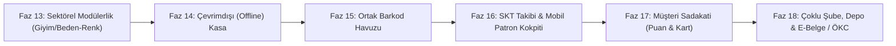

# HİMARKET SAAS & POS — MASTER FAZ YOL HARİTASI VE GÜNCEL DURUM RAPORU
**Doküman Kodu:** ROADMAP-HM-2026-V2  
**Tarih:** 19 Kasım 2026  
**Aktif Sürüm:** HiMarket Enterprise v2.6.0 (115/115 Birim Testi Başarılı)  
**Canlı Sistem:** `70.40.138.174` (`https://himarket.hayatisleri.com.tr/`)  
**Statü:** Resmi Yol Haritası & Canlı Geliştirme Takip Kılavuzu

---

## 📌 BÖLÜM 1: GEÇMİŞTEN BUGÜNE TAMAMLANAN FAZLAR (FAZ 1 — FAZ 12)
*Aşağıdaki tüm fazlar kodlanmış, 115 otomatik test ile doğrulanmış ve canlı sunucuda devreye alınmıştır.*

| Faz | Kapsam | Durum | Test Sayısı |
| :--- | :--- | :---: | :---: |
| **Faz 1** | Kritik Hata, Veri Bütünlüğü ve Türkçe Locale Düzeltmeleri | ✅ TAMAMLANDI | 67 Test |
| **Faz 2** | Mobil Responsive, Çevrimdışı Dayanıklılık ve 404 Temizliği | ✅ TAMAMLANDI | 69 Test |
| **Faz 3** | Günlük Operasyon ve CRUD Eksikleri | ✅ TAMAMLANDI | 72 Test |
| **Faz 4** | Ham Django Admin Bağımlılığını Kaldıran Özel Yönetim Sayfaları | ✅ TAMAMLANDI | 76 Test |
| **Faz 5** | Raporlama, Toplu İşlemler ve Kalite Güvencesi | ✅ TAMAMLANDI | 79 Test |
| **Faz 6** | Büyük Veri Performansı & Sayfalama (Pagination) Standardizasyonu | ✅ TAMAMLANDI | 81 Test |
| **Faz 7** | Eksik CRUD & Yönetici Aksiyonları (Güvenli Silme, Fiş İptali) | ✅ TAMAMLANDI | 84 Test |
| **Faz 8** | Eksik Raporlar, CSV Dışa Aktarımlar & Dashboard Entegrasyonu | ✅ TAMAMLANDI | 88 Test |
| **Faz 9** | Terminal Cihaz Eşleştirme & Münhasır Kasa Güvenliği (1 Kasa = 1 Terminal) | ✅ TAMAMLANDI | 92 Test |
| **Faz 10** | Kullanılabilirlik, Satış Hızı, Numpad Ergonomisi & Inline Hızlı Fiyat | ✅ TAMAMLANDI | 96 Test |
| **Faz 11** | Çoklu Mağaza (Multi-Tenancy), Şirket İzolasyonu & Sıfır Kurulum Sihirbazı | ✅ TAMAMLANDI | 103 Test |
| **Faz 12** | Kasa Başına Lisanslama, Abonelik, Süper Admin Konsolu & 403 Güvenliği | ✅ TAMAMLANDI | 115 Test |

> [!NOTE]
> **Halihazırda Çalışan Kritik MVP Özellikleri:**
> - **Terazi Ayrıştırma Motoru:** GS1 Türkiye standartlarında 27 (Ağırlık/Gramaj) ve 28 (Fiyat/Tutar) gömülü barkodları otomatik tanır.
> - **Hızlı Tuşlar & Kısayollar:** F2 Nakit, F3 Kart, F4 Beklet, F7 Kısmi, F8 İade, F9 Veresiye, Dokunmatik hızlı ürün butonları.
> - **Veresiye Defteri:** Müşteri borçlandırma, limit kontrolleri, bakiye ekstresi ve tahsilat makbuzu.

---

## 🚀 BÖLÜM 2: YENİ STRATEJİK YOL HARİTASI (FAZ 13 — FAZ 18)
*Bu fazlar işletmenin market bağımlılığını kırarak giyim, butik ve genel perakendeye açılmasını ve kurumsal seviyeye ulaşmasını sağlar.*

---

### 🟢 FAZ 13: SEKTÖREL MODÜLERLİK & VARYANT MOTORU (GİYİM / BUTİK UYUMU)
*Hedef: Programı sadece bir bakkal/market yazılımı olmaktan çıkarıp butik, giyim, ayakkabı ve tekstil mağazalarına anında satılabilir hale getirmek.*

#### A. İşlevsel Kapsam
1. **Şirket Sektör Profili (`Company.business_type`):**
   - `MARKET` (Süpermarket, Bakkal, Şarküteri, Manav): Terazi, gramaj, koli barkodu, hızlı gıda butonları aktif.
   - `APPAREL` (Giyim, Butik, Ayakkabı, Tekstil): Beden & Renk Varyant Matrisi aktif, Hediye Değişim Fişi aktif, Terazi/Gramaj gizli.
   - `RETAIL` (Kırtasiye, Kozmetik, Züccaciye, Hırdavat): Genel perakende, marka/model hiyerarşisi aktif.
2. **Varyant Matrisi (Beden × Renk):**
   - Ana Ürün (Örn: *Slim Fit Keten Gömlek*) -> Bedenler: *S, M, L, XL* / Renkler: *Mavi, Siyah, Beyaz*.
   - Tek ekranda işaretlenir; sistem otomatik 12 ayrı alt barkod ve stok kartı üretir.
   - Kasada ana ürün seçildiğinde dokunmatik ekranda "Beden / Renk Seç" balonu açılır veya her varyantın barkodu direkt okutulabilir.
3. **Fiyatsız Hediye / Değişim Fişi (Gift Receipt):**
   - Satış anında tek tıkla "Hediye Fişi Bas" seçeneği; fiyat görünmeyen, üzerinde QR/Barkod ve "30 Gün İçinde Değişim Geçerlidir" ibaresi bulunan makbuz.
4. **Cihaz & Ekran Uyumu:**
   - 1024×768 ve dokunmatik POS ekranlarında varyant seçim penceresi parmak dostu (min 44px) düğmelerle tasarlanacaktır.

#### B. Kabul Kriterleri (Doğrulama)
- Giyim mağazası olarak açılan şirkette terazi butonları görünmez.
- 1 ana modelden üretilen 12 varyantın stoku ayrı ayrı takip edilir ve satılır.
- Birim testleri yazılacak ve 115 testin üzerine eklenecektir.

---

### 🟢 FAZ 14: ÇEVRİMDIŞI (OFFLINE) KASA MOTORU (PWA + INDEXEDDB)
*Hedef: İnternet kesilse bile kasada satışın sıfır kesintiyle devam etmesi; bağlantı gelince otomatik senkronize olması.*

#### A. İşlevsel Kapsam
1. **Yerel Veri Depolama (IndexedDB):**
   - Kasa açıldığında şirketin ürün kataloğu (Barkod, Ad, Fiyat, KDV, Stok) tarayıcının IndexedDB hafızasına önbelleğe alınır.
2. **Çevrimdışı Satış Kuyruğu (`himarket_offline_queue`):**
   - İnternet kesildiğinde kasa ekranı "Çevrimdışı Mod" rozetini yakar.
   - Barkod okutma, fiş toplamı, nakit/kart tahsilat yerel olarak tamamlanır ve termal yazıcıdan fiş basılır.
   - Satış fişi IndexedDB kuyruğuna yazılır.
3. **Otomatik Arka Plan Senkronizasyonu (Background Sync):**
   - İnternet bağlantısı sağlandığı anda kuyruktaki bekleyen fişler sırayla sunucuya (`/api/sale/complete/`) iletilir ve stoklar güncellenir.

---

### 🟡 FAZ 15: ORTAK HAZIR ÜRÜN HAVUZU (GLOBAL BARKOD KATALOĞU)
*Hedef: Yeni müşteri kayıt olduğunda 10.000 ürünü tek tek elle girmekten kurtarmak; Türkiye'deki 20.000+ FMCG ürününü hazır getirmek.*

#### A. İşlevsel Kapsam
1. **Global Master Barcode Pool:**
   - Türkiye genelinde en çok tüketilen bisküvi, meşrubat, temizlik, gıda ürünlerinin hazır barkod, ad, varsayılan KDV oranı ve reyon kataloğu.
2. **Kasada Akıllı Eşleşme (Auto-Lookup):**
   - Kasiyer mağazada henüz tanımlı olmayan bir ürün okuttuğunda sistem havuzdan bulur: *"Ülker Çikolatalı Gofret bulundu. 15.00 TL satış fiyatıyla kataloğunuza eklensin mi?"*
3. **Excel / CSV Toplu İçe Aktarım (Bulk Import):**
   - Mağazanın eski programındaki stok listesini hatasız eşleştirip içeri aktarma sihirbazı.

---

### 🟡 FAZ 16: SKT & PARTİ (LOT) TAKİBİ VE MOBİL PATRON KOKPİTİ
*Hedef: Gıda ürünlerinde son kullanma tarihi yaklaşanları uyararak zayiatı önlemek; işletme sahibinin telefonundan canlı mağazasını yönetmesini sağlamak.*

#### A. İşlevsel Kapsam
1. **SKT & Parti Numarası Takibi:**
   - Mal kabulünde son kullanma tarihi (SKT) girişi.
   - Kritik SKT Raporu: *3 gün kalanlar, 7 gün kalanlar* uyarı göstergesi. Otomatik indirim/kampanya önerisi.
2. **Mobil Patron Ekranı (Mobile Boss Dashboard PWA):**
   - Telefon ekranına tam oturan, sadeleştirilmiş KPI kartları:
     - Anlık Kasa Toplamı (Nakit / Kart / Açık Hesap)
     - Günlük Net Kâr Marjı
     - İptal Edilen Fişler & Şüpheli Kasa Hareketleri
     - Kasa açık mı, hangi kasiyer çalışıyor?

---

### 🔵 FAZ 17: MÜŞTERİ SADAKATİ (LOYALTY & PUAN SİSTEMİ)
*Hedef: Müşterileri markete veya butiğe bağlamak, ciro artıran kampanya araçları sunmak.*

#### A. İşlevsel Kapsam
1. **Puan Kazanma & Harcama:**
   - Alışveriş tutarının belirlenen yüzdesi kadar puan yükleme (Örn: Her 100 TL'ye 2 TL puan).
   - Kasada puanla ödeme seçeneği.
2. **Müşteri İndirim Kartları & SMS:**
   - Telefon numarası veya müşteri kartı ile anında tanıma.

---

### 🔵 FAZ 18: ÇOKLU ŞUBE, DEPO TRANSFERLERİ & E-BELGE / ÖKC
*Hedef: Zincirleşen işletmeler ve kurumsal yasal mevzuat uyumluluğu.*

#### A. İşlevsel Kapsam
1. **Şubeler Arası Stok Transferi:** Merkez depo -> Şube 1, Şube 2 arası irsaliyeli mal sevkiyatı.
2. **Merkezi Fiyat Yönetimi:** Merkezden tek tıkla tüm şubelerin satış fiyatını güncelleme.
3. **Yeni Nesil ÖKC & E-Arşiv:** GMP-3 haberleşmesi ve entegratör üzerinden e-Arşiv / e-Fatura üretimi.

---

## 🛡️ BÖLÜM 3: ÇALIŞMA PROTOKOLÜ VE DİSİPLİN KURALLARI
1. **Adım Adım İlerleme (No Skipping):** Bir faz %100 bitip test edilmeden ve canlıda doğrulanmadan kesinlikle diğer faza geçilmeyecektir.
2. **Sıfır Regresyon (Backend Bütünlüğü):** Mevcut 115 test asla bozulmayacak, her yeni faz kendi otomatik testleriyle gelecektir.
3. **Cihaz & Ekran Ergonomisi (KodPOS & Responsive):** Yapılan her ekran 1024×768 dokunmatik kasalar, 1366×768 laptoplar, tabletler ve telefonlarda test edilerek ferah ve parmak dostu olarak teslim edilecektir.
4. **Dokümantasyon Senkronizasyonu:** Her faz tamamlandığında bu belge güncellenecek, tamamlanan ve bekleyen maddeler şeffaf tutulacaktır.
